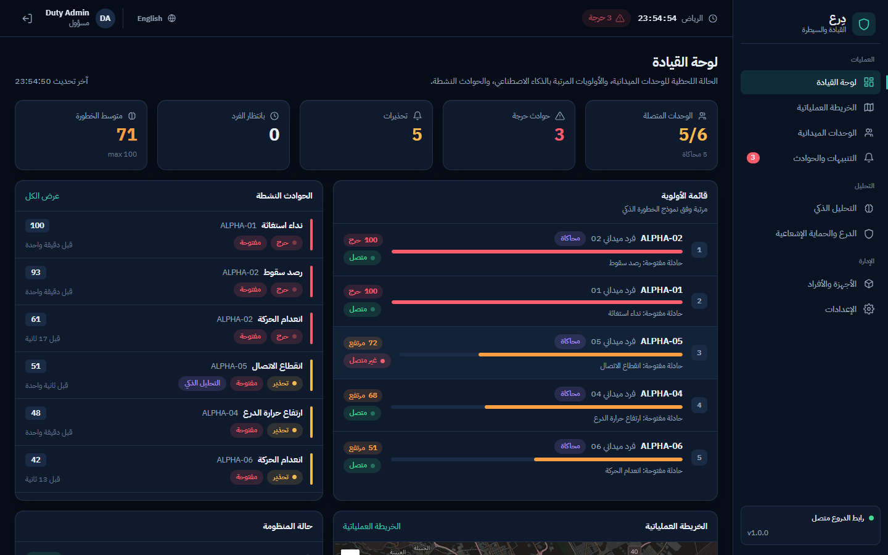
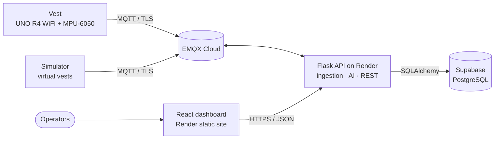
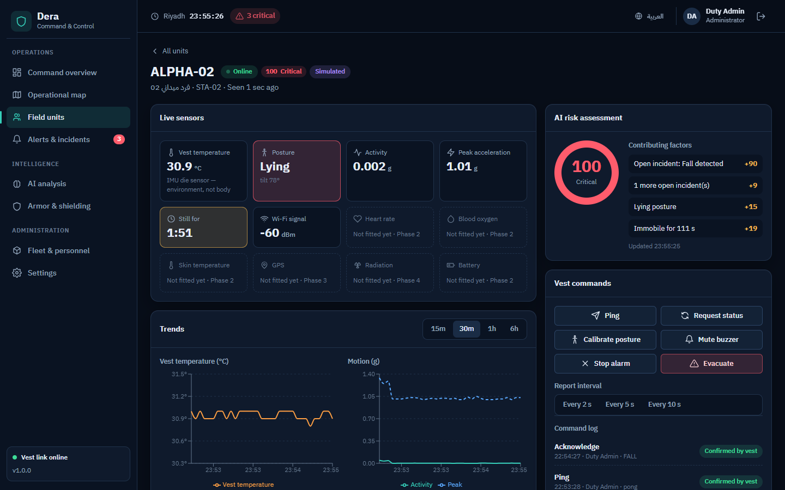
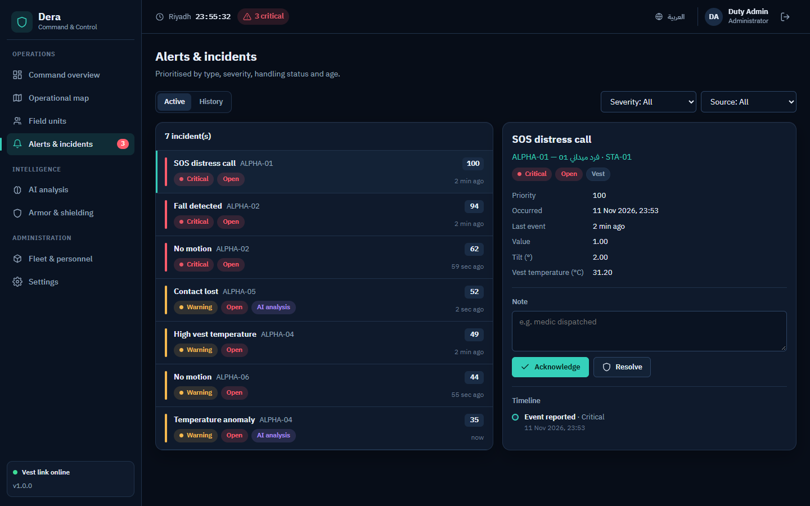
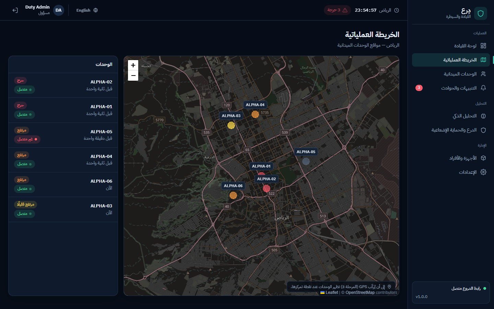
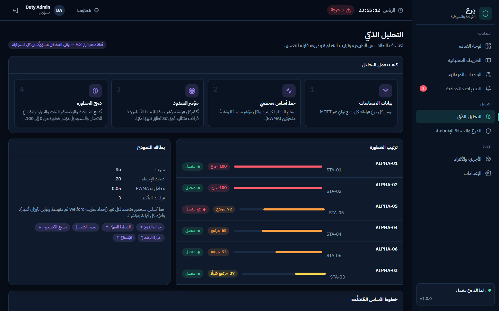
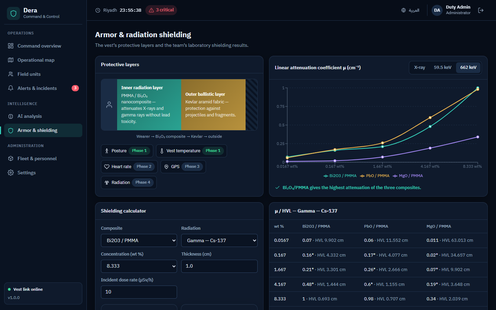
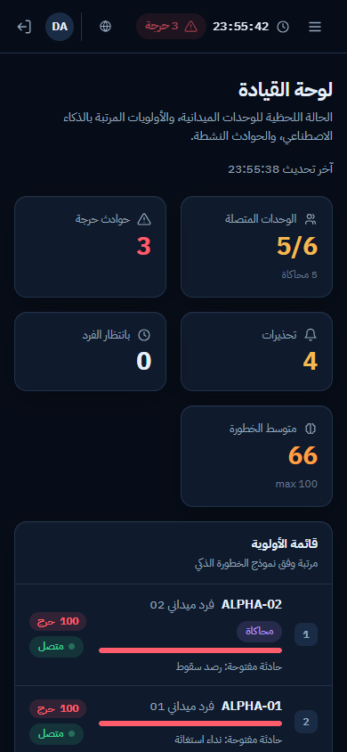

# دِرع · Dera: Smart Tactical Armor (IoT)

[](https://github.com/0-Mousa-0/SmartTacticalArmor_IoT/actions/workflows/ci.yml)

**Dera** is a multi-function tactical vest: Kevlar ballistic protection plus a PMMA/Bi₂O₃ nanocomposite
layer against radiation. It carries sensors that watch the person wearing it. The vest reports over
encrypted MQTT. A Flask backend analyses the data with explainable AI: it detects abnormal readings for each
wearer and ranks incidents by priority. An operations-room dashboard shows every unit live, in Arabic and
English.

> **دِرع** درع تكتيكي ذكي يجمع الحماية الباليستية والحماية من الإشعاع، ويرسل حالة الفرد لحظياً إلى غرفة
> العمليات. يكتشف السقوط والصدمات وانعدام الحركة وارتفاع الحرارة، ويحلّل الخادم البيانات بالذكاء
> الاصطناعي ليرصد الحالات غير الطبيعية لكل فرد ويرتّب التنبيهات حسب الأولوية.



## What it does

| Area | Capabilities |
|---|---|
| **Vest (Phase 1, built)** | Arduino UNO R4 WiFi + MPU-6050: fall detection with a 10 s "I'm OK" pre-alert, hard impact, man down, posture, no motion, heat exposure (IMU temperature), SOS button, LED-matrix feedback, store-and-forward when offline |
| **Link** | MQTT 3.1.1 over TLS (EMQX Cloud), retained status with Last Will, QoS 1 alerts, commands with correlation ids |
| **AI analysis** | A learned baseline per wearer and metric (Welford, then EWMA) with z-scores: flags readings that are abnormal *for that person* before fixed thresholds trip. A 0–100 risk score with the reasons behind it, incident priority, contact-lost detection |
| **Operations room** | Overview, live map, units ranked by risk, unit detail with trends, prioritized incidents with timeline, acknowledge (the vest is told "help is coming"), resolve, remote commands |
| **Armor** | Layer stack and the team's laboratory shielding data, with a Beer–Lambert dose calculator |
| **Security** | Sign-in with roles (admin / operator / viewer), or open access without sign-in for demos (`PUBLIC_ACCESS_ROLE`); per-device broker credentials; secrets only in environment variables |
| **Vital signs** | MAX30102 heart rate and SpO₂ measured on the vest (own beat detection and ratio-of-ratios SpO₂, tested on synthetic pulse waves), with alarms and trends |
| **Next phases** | Skin temperature (2), GPS (3), radiation counter (4). The protocol, database and dashboard already accept these |

## Architecture



| Part | Technology | Structure |
|---|---|---|
| [backend/](backend/README.md) | Python 3.12, Flask, flask-restx, SQLAlchemy, Alembic, paho-mqtt | N-tier: endpoints → facade → services / repositories → models |
| [frontend/](frontend/README.md) | React 18, TypeScript, Vite, TanStack Query, Leaflet, Recharts | Clean architecture per feature (domain / data / application / presentation), enforced by ESLint |
| [firmware/](firmware/README.md) | Arduino C++, ArduinoMqttClient, ArduinoJson | Modules with hardware-free logic, unit-tested on a PC |
| [tools/](tools/simulator/README.md) | Python simulator, end-to-end checker | Speaks the real protocol |
| [docs/](docs/README.md) | Plan, UML, API, protocol, setup guides | Mermaid diagrams |

The complete end-to-end block diagram, with all vest equipment (built and planned) and every protocol,
language, framework and version, is in
[docs/10-technical-overview.md](docs/10-technical-overview.md).

## Try it on your computer (no cloud accounts)

Requires Python 3.12 and Node 20–24. Use four PowerShell windows from the repository root.

```powershell
# 1) Local MQTT broker (127.0.0.1:18830)
cd tools/e2e; npm install; npm run broker
```

```powershell
# 2) Backend on SQLite, connected to the local broker
cd backend
python -m venv .venv; .\.venv\Scripts\Activate.ps1; pip install -r requirements-dev.txt
$env:FLASK_ENV="development"; $env:DATABASE_URL=""
flask --app wsgi db upgrade; flask --app wsgi seed-demo
$env:MQTT_ENABLED="true"; $env:MQTT_HOST="127.0.0.1"; $env:MQTT_PORT="18830"; $env:MQTT_TLS="false"
$env:BOOTSTRAP_ADMIN_EMAIL="admin@sta.local"; $env:BOOTSTRAP_ADMIN_PASSWORD="ChangeMe-2026"
python run.py                                    # API + Swagger UI: http://localhost:5000/api/v1/docs
```

```powershell
# 3) Six virtual vests playing the 9-minute demo scenario (uses the backend's virtual environment)
cd tools/simulator
..\..\backend\.venv\Scripts\python vest_simulator.py --host 127.0.0.1 --port 18830 --no-tls `
  --devices STA-01,STA-02,STA-03,STA-04,STA-05,STA-06 --interval 1 --demo
```

```powershell
# 4) Dashboard
cd frontend; npm ci; npm run dev                 # http://localhost:5173, sign in as admin@sta.local
```

## Go live

| Step | Guide | You get |
|---|---|---|
| 1. Database | [Supabase setup](docs/06-setup-supabase.md) | `DATABASE_URL` |
| 2. Broker | [EMQX setup](docs/07-setup-emqx.md) | Broker address and three accounts |
| 3. Hosting | [Render deployment](docs/08-deploy-render.md) | `https://…onrender.com` API and dashboard |
| 4. Vest | [Firmware guide](firmware/README.md) | STA-01 reporting live |

### Push to GitHub

Create an **empty** repository named `SmartTacticalArmor_IoT` under `0-Mousa-0` (no README, no
.gitignore), then run:

```powershell
git remote add origin https://github.com/0-Mousa-0/SmartTacticalArmor_IoT.git
git push -u origin main
```

CI starts on the first push. If you choose another repository name, update the badge link at the top.

## Quality

| Check | Result |
|---|---|
| Backend tests (pytest) | 77 passed on SQLite (the earlier 69 also on PostgreSQL) |
| Backend lint (ruff) · migrations in sync (`db check`) | clean · no drift |
| Frontend lint with architecture rules, type check, tests (Vitest), build | 27 passed, 0 warnings |
| Firmware logic tests on a PC · build for UNO R4 WiFi | 65 checks passed · 0 warnings, 40 % flash |
| End to end over MQTT (simulator → broker → backend → API) | 18 / 18 passed |

How the project is tested and released: [docs/09-scm-and-qa.md](docs/09-scm-and-qa.md).

## Screenshots

| | |
|---|---|
|  |  |
| **Unit detail:** live sensors, AI risk and its reasons, trends, commands | **Incidents:** priority queue and timeline, acknowledge and resolve |
|  |  |
| **Operational map** (Arabic, RTL) | **AI analysis:** per-wearer baselines and risk ranking |
|  |  |
| **Armor and radiation shielding** | **Phone layout** |

## Project status

Phase 1 hardware (IMU) is built and tested end to end. The software is ready for Phase 2–4 sensors. See the
[roadmap](docs/01-high-level-plan.md#4-phased-roadmap). This is a research prototype, not a certified
safety or medical device.

The first prototype (v1 firmware and the single-page dashboard) is archived in [legacy/](legacy/README.md).
