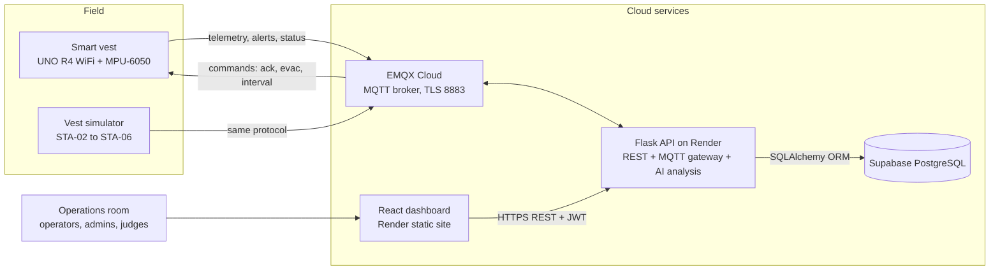

# Dera — Smart Tactical Armor · High-Level Plan

> **ملخص تنفيذي** — «دِرع» درع تكتيكي متعدد الوظائف يجمع بين الحماية الباليستية (كيفلار)
> والحماية من الإشعاع (متراكب PMMA/Bi₂O₃ النانوي). يحمل الدرع حساسات تراقب حالة الفرد،
> وترسل بياناتها عبر MQTT المشفّر إلى خادم Flask. يحلّل الخادم البيانات بالذكاء الاصطناعي،
> فيكتشف الحالات غير الطبيعية ويرتّب التنبيهات حسب الأولوية، ثم يعرض كل ذلك على لوحة قيادة
> وسيطرة (React) في غرفة العمليات. المرحلة الأولى مبنية ومختبرة على Arduino UNO R4 WiFi
> وحساس الحركة MPU-6050 (السقوط، الصدمات، الوضعية، انعدام الحركة، حرارة الدرع). المعمارية
> جاهزة لإضافة النبض والأكسجين والحرارة الجلدية وGPS والإشعاع في المراحل التالية.

---

## Table of contents
1. [Problem and objective](#1-problem-and-objective)
2. [Scope of this repository](#2-scope-of-this-repository)
3. [System overview](#3-system-overview)
4. [Phased roadmap](#4-phased-roadmap)
5. [Requirements](#5-requirements)
6. [Architecture decisions](#6-architecture-decisions)
7. [Free-tier budgets](#7-free-tier-budgets-and-how-the-design-fits-them)
8. [Risks and mitigations](#8-risks-and-mitigations)
9. [Milestones](#9-milestones)
10. [Quality gates](#10-quality-gates-and-current-status)

Related: [Structural UML](02-uml-structural.md) · [Behavioral UML](03-uml-behavioral.md) ·
[REST API](04-api-reference.md) · [MQTT protocol](05-mqtt-protocol.md)

---

## 1. Problem and objective

Security and field personnel face several threats at once: projectiles, harmful radiation, and medical
emergencies that nobody sees in time. Conventional protective equipment covers one threat and says nothing
about the wearer. Lead-based radiation shielding is also heavy and toxic.

**Objective (SAIF competition proposal):** a multi-function tactical vest with two layers:

* **Outer ballistic layer:** Kevlar aramid fabric.
* **Inner radiation layer:** a PMMA / Bi₂O₃ nanocomposite. In the team's lab measurements it attenuated
  X-rays and gamma rays better than PMMA/PbO, without lead toxicity.

It also carries **integrated sensing** (vitals, temperature, motion, position, radiation) and an **AI
analysis** chain that detects abnormal situations and sends **prioritized alerts** to the operations room.

## 2. Scope of this repository

This repository delivers the **electronics, software and AI** part of the concept. The materials-science
part is outside the code; its lab measurements are used in the *Armor & shielding* page.

| In scope | Out of scope (for now) |
|---|---|
| Vest firmware (Arduino UNO R4 WiFi + MPU-6050) | Ballistic and radiation material manufacturing |
| Secure device → cloud messaging (MQTT/TLS) | Certified medical or dosimetry accuracy |
| Flask backend (n-tier), PostgreSQL on Supabase | Video streaming from the vest (needs a camera + WebRTC) |
| Explainable AI analysis (anomaly detection, risk, priority) | Trained deep-learning models (Phase 5, needs labelled data) |
| React command & control dashboard (AR/EN) | Native mobile app |
| Virtual vests for demos, end-to-end tests, CI | |
| Deployment on Render | |

## 3. System overview

**Data path:** sensor data → **AI analysis** (per-wearer baselines, anomaly z-scores, risk fusion) →
**operations room** (prioritized alerts, wearer status, location). This follows the concept diagram:
*Sensor data → AI analysis → Operations room*.

## 4. Phased roadmap

| Phase | Hardware | Software deliverables | Status |
|---|---|---|---|
| **1 — Motion & environment** | UNO R4 WiFi, MPU-6050, optional SOS button | Fall / impact / man-down with a 10 s "I'm OK" pre-alert, posture, no-motion, vest temperature; full backend, AI analysis, dashboard, simulator, deployment | ✅ **Done** (this repo) |
| 2 — Vitals | MAX30102 (HR + SpO₂), MAX30205 (skin temperature), battery divider | Port drivers from `legacy/`; enable `vit` / `bat` payload sections. Backend, AI metrics and dashboard tiles already exist | Ready to integrate |
| 3 — Location | GPS (NEO-6M / M8N) | `gps` section; map switches from "assigned post" to live GPS automatically | Ready to integrate |
| 4 — Radiation | Geiger counter (J305 / M4011) | `rad` section; dose behind the Bi₂O₃ layer using the shielding model | Ready to integrate |
| 5 — Learned AI | Same | Train a model (e.g. isolation forest / LSTM) on the data collected in phases 1–4, behind the same `AnomalyDetector` interface | Planned |

Phase 2–4 alert types, database columns, API fields and dashboard tiles are **already implemented**. Adding a
sensor only means adding its firmware module.

## 5. Requirements

### Functional

| ID | Requirement | Implemented in |
|---|---|---|
| FR-01 | The vest detects falls, hard impacts and "man down" and gives the wearer 10 s to cancel | `firmware/.../motion/FallDetector`, `alerts/AlertManager` |
| FR-02 | The vest reports posture, activity, inactivity and vest temperature periodically | `firmware/.../app/Payloads`, `SmartTacticalArmor.ino` |
| FR-03 | The wearer can raise SOS (hold 2 s) | `input/SosButton` |
| FR-04 | Alerts survive network loss (store-and-forward) and are timestamped when they happened | `alerts/AlertOutbox`, backend `_event_time` |
| FR-05 | The operations room sees every unit live: wearer, connection, sensors, risk, position | `GET /devices`, *Field units*, *Unit detail*, *Map* pages |
| FR-06 | Incidents are listed by priority and handled: acknowledge (vest is notified) → resolve | `AlertFacadeMixin`, *Alerts* page |
| FR-07 | Operators send commands to a vest (ping, ack, evacuate, stop, interval, mute, calibrate, status) and see the result | `CommandFacadeMixin`, *Command panel* |
| FR-08 | AI analysis learns each wearer's normal values and flags persistent anomalies | `services/analysis/anomaly_detector.py` |
| FR-09 | AI analysis fuses everything into a 0–100 risk score with explained factors | `services/analysis/risk_engine.py` |
| FR-10 | Lost contact with a vest raises an alert automatically | `MaintenanceFacadeMixin` + MQTT Last Will |
| FR-11 | Admins manage vests, wearers and operator accounts | *Fleet*, *Settings* pages, `/devices`, `/personnel`, `/operators` |
| FR-12 | The dashboard shows the vest's shielding performance from the team's lab data | `services/analysis/shielding.py`, *Armor* page |
| FR-13 | The interface is available in Arabic (RTL, default) and English | `frontend/src/core/i18n` |

### Non-functional

| ID | Requirement | How |
|---|---|---|
| NFR-01 | Security | TLS device link with per-device credentials; JWT sessions; roles admin / operator / viewer; login rate limit; RLS on Supabase tables; secrets only in env vars |
| NFR-02 | Maintainability | n-tier backend (API → facade → services → repositories → models); clean-architecture frontend with lint-enforced layer rules; modular firmware |
| NFR-03 | Testability | 69 backend, 17 frontend and 49 firmware unit checks; 18-check end-to-end MQTT test; CI on every push |
| NFR-04 | Portability | The same schema runs on SQLite (tests) and Postgres (prod); broker-agnostic MQTT 3.1.1 |
| NFR-05 | Cost | Runs entirely on free tiers (Render, Supabase, EMQX). Budgets in §7 |
| NFR-06 | Latency | Vest → dashboard under 6 s at the default 5 s interval (2 s in demo mode); alerts are event-driven |
| NFR-07 | Transparency | Every AI output is explainable (value, usual value, σ distance, factor list) and labelled *decision support* |

## 6. Architecture decisions

| # | Decision | Why | Alternatives considered |
|---|---|---|---|
| AD-1 | **MQTT over TLS via a managed broker (EMQX Cloud Serverless)** | Designed for constrained devices; the Last Will gives instant offline detection; QoS 1 plus persistent sessions keep alerts while the API sleeps. HiveMQ's free *Serverless* plan stops accepting new clusters and shuts down on 2026-12-31, so EMQX's free tier was chosen | HTTPS POST from the vest (simpler, but no push commands and no Last Will); self-hosted Mosquitto (needs an always-on VM) |
| AD-2 | **The MQTT gateway runs inside the Flask web service** | Render's free plan has no background workers; one gunicorn worker owns one persistent MQTT session | Separate Render worker ($7/month). `app.runtime` makes this a deploy-time choice |
| AD-3 | **Layered backend + facade (HBnB / Zaytona style)** | One entry point per use case; API and MQTT adapters share the business logic; repositories never commit (unit of work) | Fat controllers; service-per-entity |
| AD-4 | **SQLAlchemy with portable column types + Alembic** | The same models run on SQLite in tests and Postgres in production; verified on both | Supabase client SDK (would bypass the n-tier backend) |
| AD-5 | **Dashboard polls the REST API (2–5 s)** | Freshness is bounded by the vest's 5 s report interval, so websockets would not make the data fresher. Polling also survives Render sleeps and redeploys | Socket.IO (more moving parts on a free single instance) |
| AD-6 | **Explainable statistical AI first** | No labelled data exists yet. Per-wearer EWMA baselines with z-scores are cheap, need no training, and every alert can be explained to an operator | Training an ML model on synthetic data (would only look intelligent) |
| AD-7 | **Clean architecture in React** (domain / data / application / presentation per feature) | UI never calls `fetch`; repositories are swappable (tests use fakes); ESLint enforces the dependency rule | Pages calling `fetch` directly |
| AD-8 | **Arabic RTL first, full English translation** | Primary users are Saudi operations rooms; judges and partners may read English | Arabic only |
| AD-9 | **Virtual vests through the real protocol** | Demos with one physical vest still show a full force, honestly labelled "Simulated"; the same tool drives end-to-end tests | Fake data inside the dashboard |

## 7. Free-tier budgets and how the design fits them

| Service (free tier) | Limit | Design response |
|---|---|---|
| **EMQX Serverless** | 1 GB traffic + 1 M session-minutes / month | 5 s telemetry (~250 MB/month per vest, both directions). Switch to 2 s only for live demos. Compact JSON, alerts are event-based |
| **Supabase** | 500 MB database | History stored at most every 5 s and only when something changed; 7-day retention purge; live state cached on the `devices` row |
| **Render web service** | 750 h/month; sleeps after 15 min without HTTP traffic | Persistent MQTT session: the broker queues QoS-1 alerts while the API sleeps. An open dashboard keeps it awake. Optional uptime ping or the $7 Starter plan for 24/7 |
| **Render static site** | Free CDN hosting | React build served as static files |

## 8. Risks and mitigations

| Risk | Impact | Mitigation |
|---|---|---|
| Wi-Fi or TLS reconnection blocks the R4 for a few seconds | IMU sampling pauses during reconnects | Reconnects are rare; outbox keeps alerts; MPU-6050 FIFO buffering is planned |
| Free API instance asleep during an incident | Telemetry gap until it wakes (~1 min) | QoS-1 alerts are queued by the broker (persistent session); keep-awake option documented; Starter plan for operations |
| The MPU die temperature is not body temperature | Misinterpretation | Labelled "vest / environment temperature" everywhere; body temperature arrives in Phase 2 |
| Thresholds tuned on a prototype | False alarms or misses | All thresholds in `config.h` / env vars; pre-alert lets the wearer cancel; AI adapts per wearer |
| Free broker policy changes (as happened with HiveMQ) | Device link down | Broker-agnostic MQTT 3.1.1; switching broker = change host and credentials only |
| Credentials leaked from the repo | Device or DB compromise | Secrets only in git-ignored files or env vars; per-device MQTT users with topic ACLs |

## 9. Milestones

| Sprint | Outcome |
|---|---|
| S1 — Foundations | Repo scaffold, legacy archived, data model, migrations, backend skeleton with tests |
| S2 — Device link | MQTT protocol, gateway, ingestion of telemetry, alerts, status and responses; commands |
| S3 — Intelligence | Anomaly detection, risk engine, alert priority, contact-lost, shielding model |
| S4 — Dashboard | 10 pages, AR/EN, map, charts, role-aware actions |
| S5 — Hardware | Modular firmware, host tests, on-board compile, demo moves |
| S6 — Release | Simulator, end-to-end test, CI, Supabase / EMQX / Render guides, UML and plan |
| Next | Phase 2 sensors; field trials to tune thresholds; collect labelled data for Phase 5 |

## 10. Quality gates and current status

| Gate | Command | Result |
|---|---|---|
| Backend unit + API tests (SQLite) | `cd backend && pytest` | **69 passed** |
| Same suite on PostgreSQL | `TEST_DATABASE_URL=postgresql://… pytest` | **passed** (verified on a Postgres server) |
| Migrations match the models; RLS applied | `flask db upgrade && flask db check` | **no drift** |
| Backend lint | `ruff check .` | **clean** |
| Frontend lint (incl. layer rules), types, tests, build | `npm run lint && npm test && npm run build` | **27 passed, 0 warnings** |
| Firmware logic | `firmware/test/run_tests.sh` | **65 checks passed** |
| Firmware build for the board | `arduino-cli compile --fqbn arduino:renesas_uno:unor4wifi` | **0 warnings**, 40 % flash, 36 % RAM |
| End-to-end over MQTT | `tools/e2e/README.md` | **18 / 18 passed** |
| Visual QA | headless browser screenshots, AR/EN, desktop + phone | reviewed |

Details: [SCM and QA](09-scm-and-qa.md).
