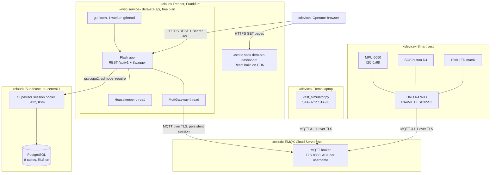
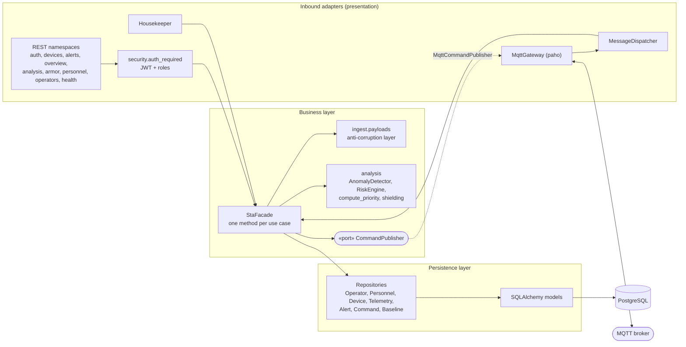
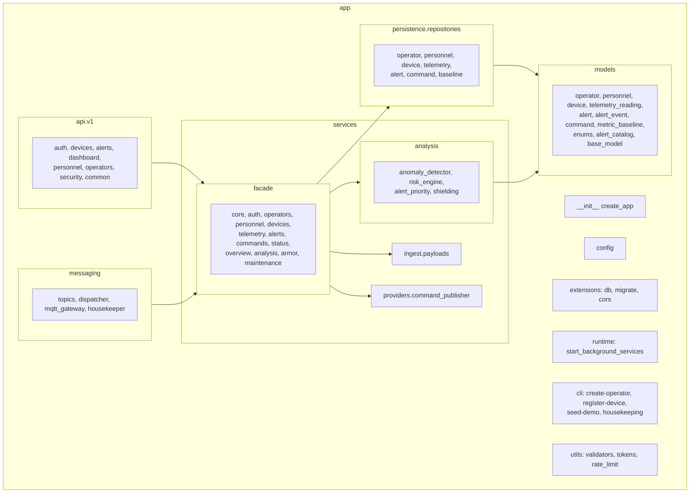
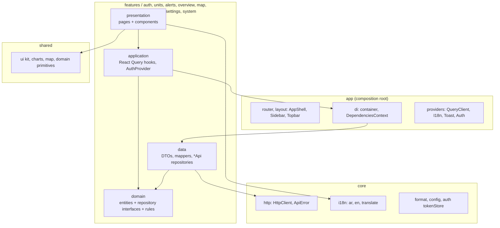
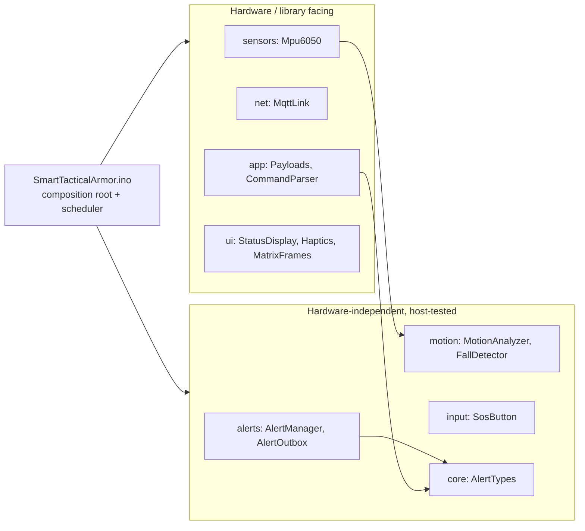
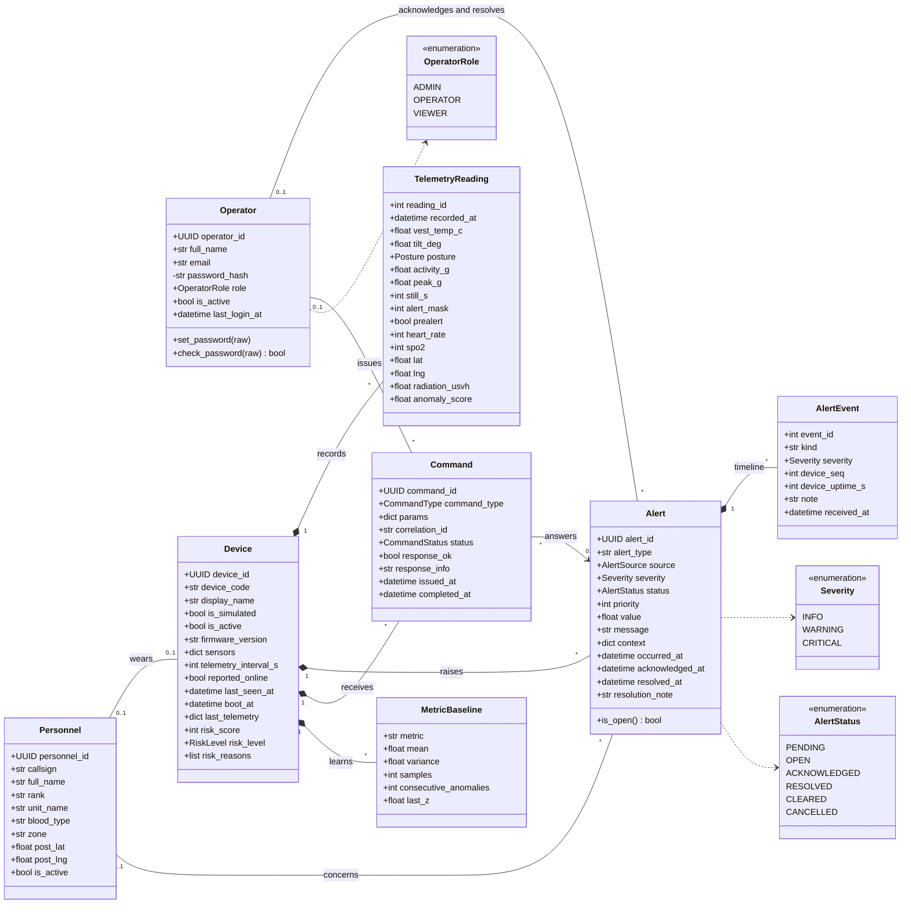
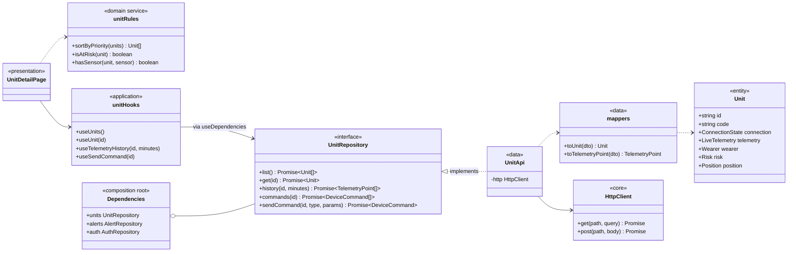
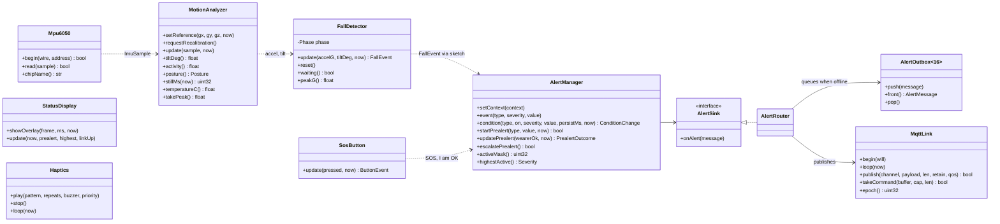
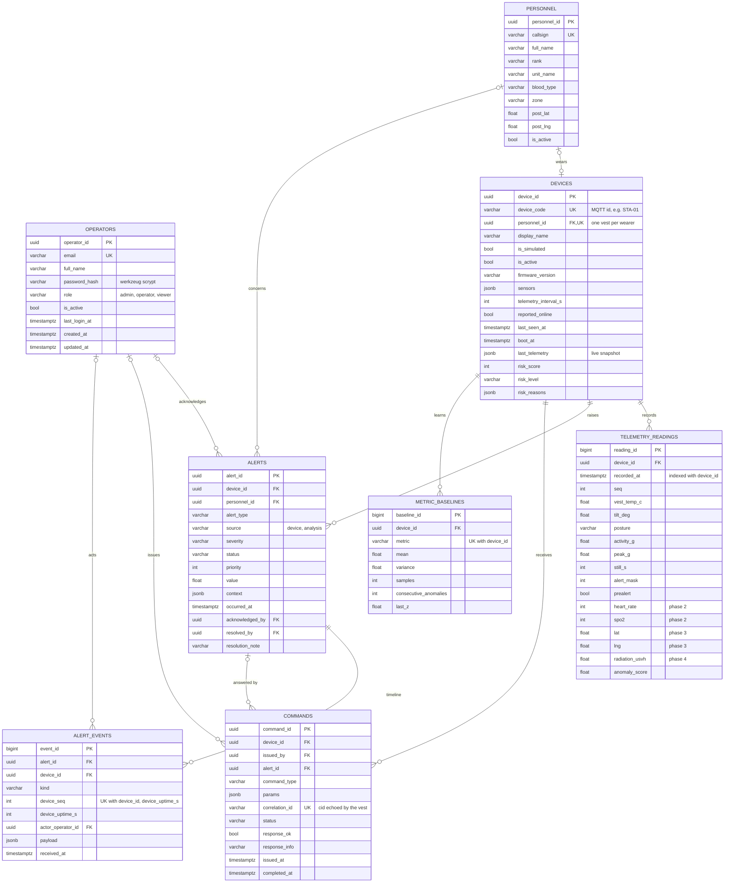

# Structural UML

How the system is built: where each part runs, how the code is layered, and how data is stored.
Every name below matches the code. Behaviour (sequences, state machines, activities) is in
[03-uml-behavioral.md](03-uml-behavioral.md).

## Contents
1. [Deployment diagram](#1-deployment-diagram)
2. [Component diagram (backend)](#2-component-diagram-backend)
3. [Package diagrams](#3-package-diagrams)
4. [Domain model (class diagram)](#4-domain-model-class-diagram)
5. [Backend layers (class diagram)](#5-backend-layers-class-diagram)
6. [Frontend clean architecture (class diagram)](#6-frontend-clean-architecture-class-diagram)
7. [Firmware modules (class diagram)](#7-firmware-modules-class-diagram)
8. [Entity-relationship diagram](#8-entity-relationship-diagram)

---

## 1. Deployment diagram

| Node | Runtime | Notes |
|---|---|---|
| Smart vest | Arduino C++17 (Renesas core 1.6) | 106 KB flash, 12.1 KB RAM |
| EMQX Cloud | Managed MQTT 5 / 3.1.1 broker | TLS only; free 1 GB/month |
| Render web service | Python 3.12, gunicorn 27, Flask 3.1 | Migrations run at start; health check `/api/v1/health` |
| Render static site | Vite build of React 18 | SPA rewrite `/* → /index.html` |
| Supabase | PostgreSQL via the session pooler | Render has no outbound IPv6, so the IPv4 pooler is required |

## 2. Component diagram (backend)

**Rules:**

* Inbound adapters call only the facade.
* The facade calls services, repositories and ports.
* Repositories never commit. The facade opens one transaction per use case (unit of work).

## 3. Package diagrams

### Backend (`backend/app`)

### Frontend (`frontend/src`) — clean architecture per feature

The dependency rule *presentation → application → domain ← data* is enforced by ESLint
(`no-restricted-imports` per layer in `frontend/eslint.config.js`).

### Firmware (`firmware/SmartTacticalArmor`)

## 4. Domain model (class diagram)

## 5. Backend layers (class diagram)

```mermaid
classDiagram
    direction TB
    class StaFacade {
        +operators OperatorRepository
        +personnel PersonnelRepository
        +devices DeviceRepository
        +telemetry TelemetryRepository
        +alerts AlertRepository
        +commands CommandRepository
        +baselines BaselineRepository
        +anomaly_detector AnomalyDetector
        +risk_engine RiskEngine
        +publisher CommandPublisher
        +transaction() contextmanager
    }
    class TelemetryFacadeMixin {
        +ingest_telemetry(device_code, raw, received_at) dict
    }
    class AlertFacadeMixin {
        +ingest_device_alert(device_code, raw, received_at) dict
        +list_alerts(scope, severity, source, device_id) dict
        +acknowledge_alert(alert_id, operator_id, note) dict
        +resolve_alert(alert_id, operator_id, note) dict
    }
    class CommandFacadeMixin {
        +send_command(device_id, type, params, operator_id) dict
        +ingest_command_response(device_code, raw) dict
    }
    class StatusFacadeMixin {
        +ingest_status(device_code, raw, received_at, retained) dict
    }
    class MaintenanceFacadeMixin {
        +run_housekeeping(now) dict
    }
    class AuthFacadeMixin {
        +login(email, password, client_ip) dict
        +authenticate_token(token) Operator
    }
    class AnomalyDetector {
        +z_threshold float
        +warmup_samples int
        +alpha float
        +evaluate(metric, value, state) MetricEvaluation
    }
    class RiskEngine {
        +assess(inputs) RiskAssessment
    }
    class CommandPublisher {
        <<abstract>>
        +publish_command(device_code, message) bool
    }
    class MqttCommandPublisher
    class NullCommandPublisher
    class RecordingCommandPublisher
    class MqttGateway {
        +connected bool
        +start()
        +publish(topic, message, qos) bool
        +health() dict
    }
    class MessageDispatcher {
        +dispatch(topic, payload, retained, received_at) str
    }
    class Housekeeper {
        +run()
        +stop()
    }
    class AlertRepository {
        +add(alert)
        +find_open(device_id, alert_type) Alert
        +search(filter) tuple
        +device_event_exists(device_id, seq, uptime_s) bool
    }

    StaFacade --|> TelemetryFacadeMixin
    StaFacade --|> AlertFacadeMixin
    StaFacade --|> CommandFacadeMixin
    StaFacade --|> StatusFacadeMixin
    StaFacade --|> MaintenanceFacadeMixin
    StaFacade --|> AuthFacadeMixin
    StaFacade o-- AnomalyDetector
    StaFacade o-- RiskEngine
    StaFacade o-- CommandPublisher
    StaFacade o-- AlertRepository
    CommandPublisher <|-- MqttCommandPublisher
    CommandPublisher <|-- NullCommandPublisher
    CommandPublisher <|-- RecordingCommandPublisher
    MqttCommandPublisher --> MqttGateway
    MqttGateway --> MessageDispatcher
    MessageDispatcher ..> StaFacade : calls use cases
    Housekeeper ..> StaFacade : run_housekeeping
```

`StaFacade` also mixes in `FacadeCoreMixin`, `OperatorFacadeMixin`, `PersonnelFacadeMixin`, `DeviceFacadeMixin`,
`OverviewFacadeMixin`, `AnalysisFacadeMixin` and `ArmorFacadeMixin`. They are omitted above for readability.

## 6. Frontend clean architecture (class diagram)

The *units* feature is shown. Every feature follows the same shape.

## 7. Firmware modules (class diagram)

## 8. Entity-relationship diagram

**Storage notes:**

* Column types are portable: `UUIDType`, `JSONType` (JSONB on Postgres) and `UTCDateTime`. The same models run
  on SQLite in tests.
* `telemetry_readings` is down-sampled (every 5 s at most, plus every alert change) and purged after 7 days.
* The `uq_alert_events_device_message` constraint makes alert ingestion idempotent under MQTT QoS 1 redelivery.
* Migration `0002_enable_rls` enables Row-Level Security on every table (Supabase Data API hardening).
