# Behavioral UML

How the system behaves at run time: who uses it, how messages flow, and the life cycle of the
main objects. Every step names the real method, topic or endpoint. Structure is in
[02-uml-structural.md](02-uml-structural.md).

## Contents
1. [Use case diagram](#1-use-case-diagram)
2. [Sequence diagrams](#2-sequence-diagrams)
   - 2.1 [Telemetry ingestion and AI analysis](#21-telemetry-ingestion-and-ai-analysis)
   - 2.2 [Fall: pre-alert, escalation, acknowledgement](#22-fall-pre-alert-escalation-acknowledgement)
   - 2.3 [Operator command with correlation id](#23-operator-command-with-correlation-id)
   - 2.4 [Vest start-up, Last Will and lost contact](#24-vest-start-up-last-will-and-lost-contact)
   - 2.5 [Operator sign-in and a role-protected request](#25-operator-sign-in-and-a-role-protected-request)
   - 2.6 [Dashboard live refresh](#26-dashboard-live-refresh)
3. [State machines](#3-state-machines)
   - 3.1 [Firmware fall detector](#31-firmware-fall-detector)
   - 3.2 [Incident (alert) life cycle](#32-incident-alert-life-cycle)
   - 3.3 [Command life cycle](#33-command-life-cycle)
   - 3.4 [Vest connectivity](#34-vest-connectivity)
4. [Activity diagrams](#4-activity-diagrams)
   - 4.1 [Firmware main loop](#41-firmware-main-loop)
   - 4.2 [AI analysis of one telemetry message](#42-ai-analysis-of-one-telemetry-message)

---

## 1. Use case diagram

**1a. Operations room**: the people who use the dashboard.

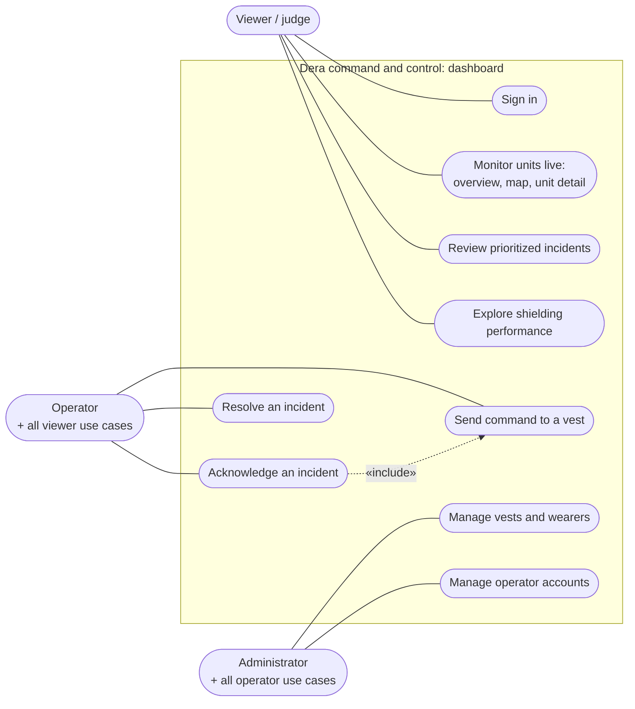

**1b. Vest and automated analysis**: the wearer, the vest firmware and the server-side AI.

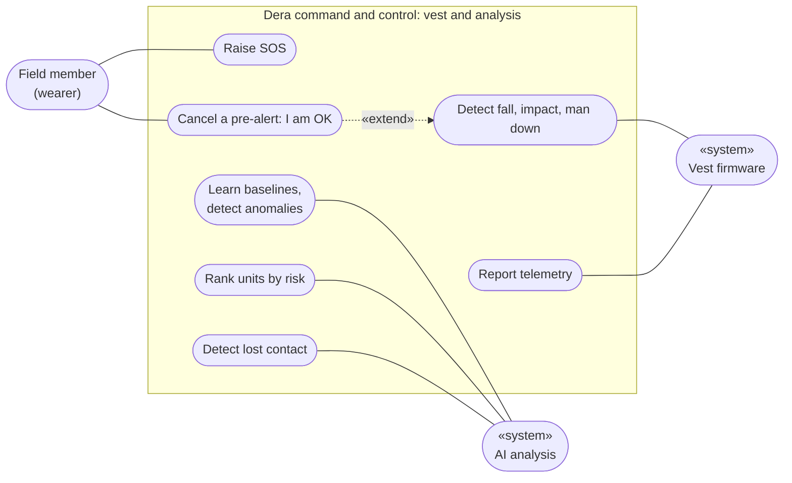

The roles are cumulative: an operator can do everything a viewer can, and an administrator everything
an operator can. The API enforces this with the `viewer`, `operator` and `admin` roles. «include»:
acknowledging an incident always sends the `ack` command to the vest. «extend»: the wearer's "I am OK" is
an optional extension of fall detection.

| Actor | Role in the system | Permissions |
|---|---|---|
| Field member | Wears the vest; can raise SOS or cancel a suspected fall | Physical button only |
| Operator | Watches the operations room, handles incidents, sends commands | `operator` role |
| Administrator | Everything an operator can do, plus fleet and account management | `admin` role |
| Viewer / judge | Read-only access for supervisors or competition judges | `viewer` role |
| Vest firmware | Sensing, local alert logic, MQTT client | Per-device MQTT credentials |
| AI analysis | Server-side anomaly detection, risk fusion, contact-lost detection | Runs inside the backend |

## 2. Sequence diagrams

### 2.1 Telemetry ingestion and AI analysis

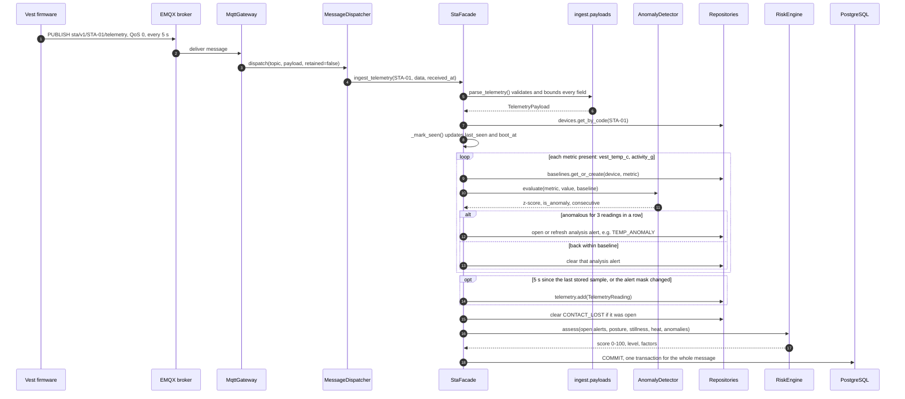

### 2.2 Fall: pre-alert, escalation, acknowledgement

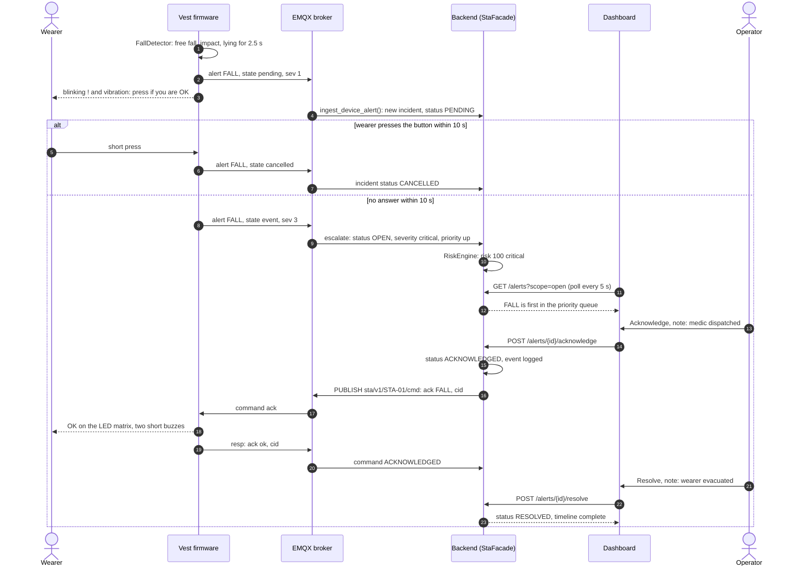

### 2.3 Operator command with correlation id

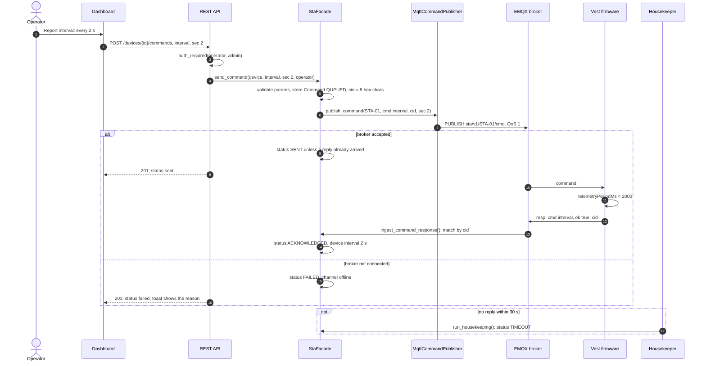

### 2.4 Vest start-up, Last Will and lost contact

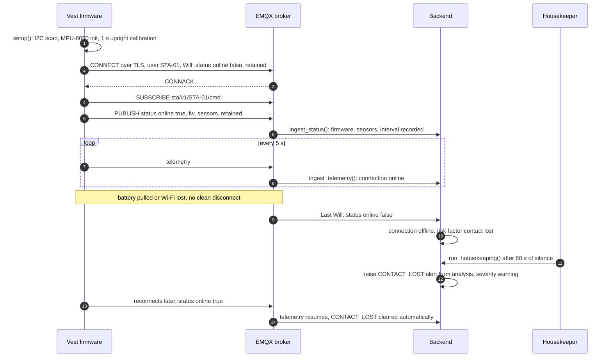

### 2.5 Operator sign-in and a role-protected request

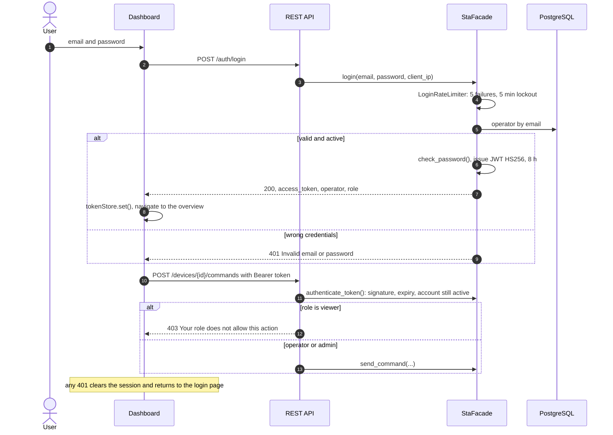

### 2.6 Dashboard live refresh

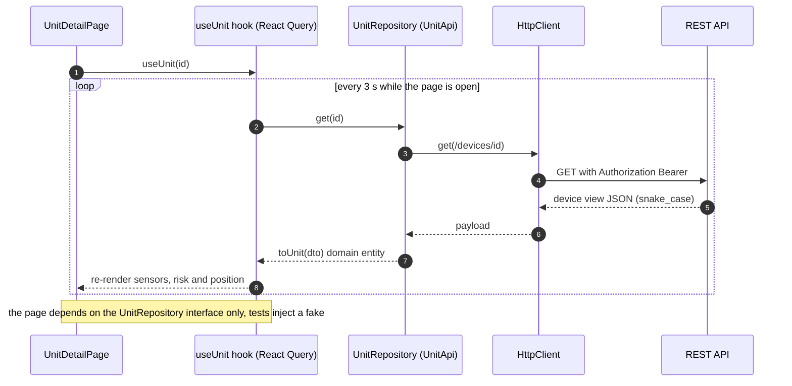

## 3. State machines

### 3.1 Firmware fall detector

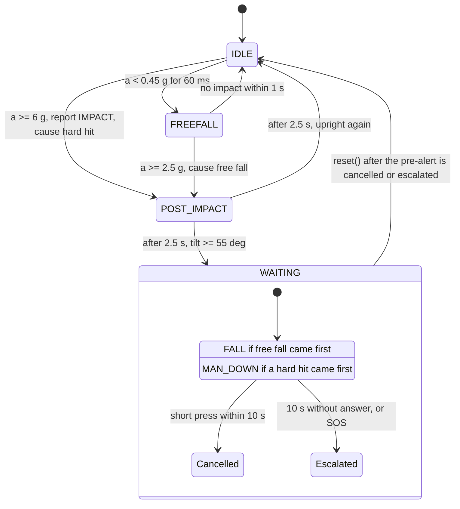

### 3.2 Incident (alert) life cycle

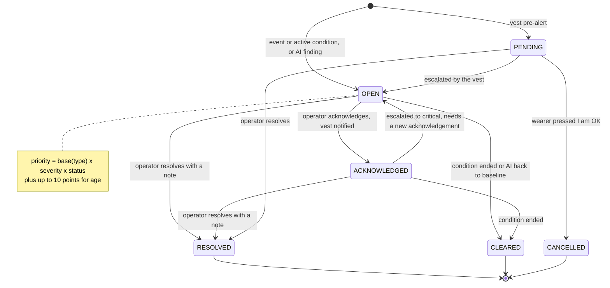

### 3.3 Command life cycle

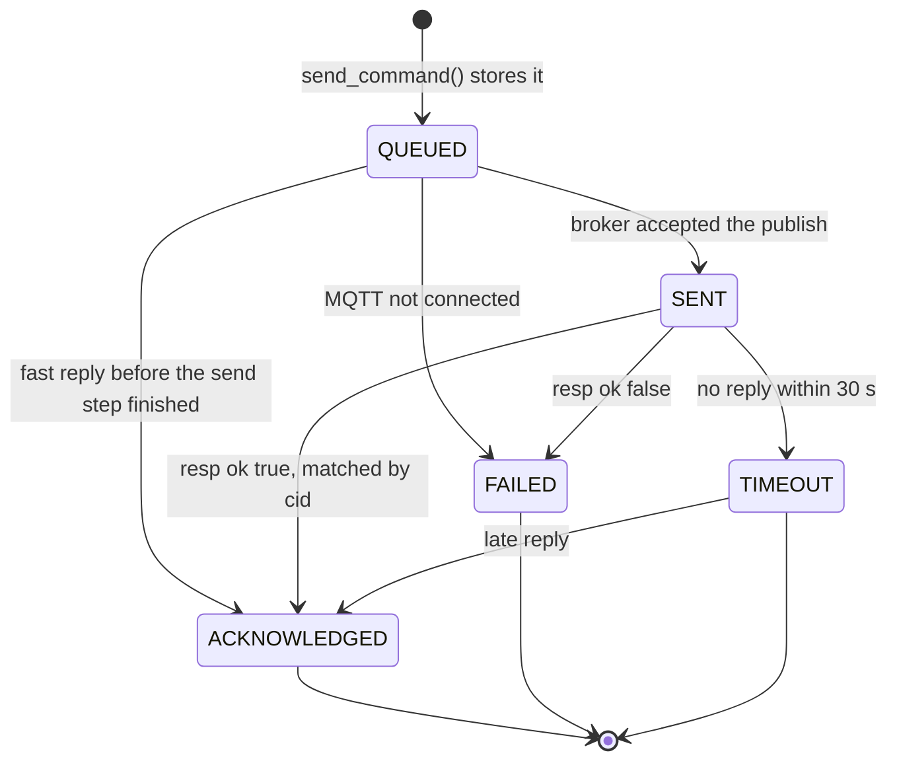

### 3.4 Vest connectivity

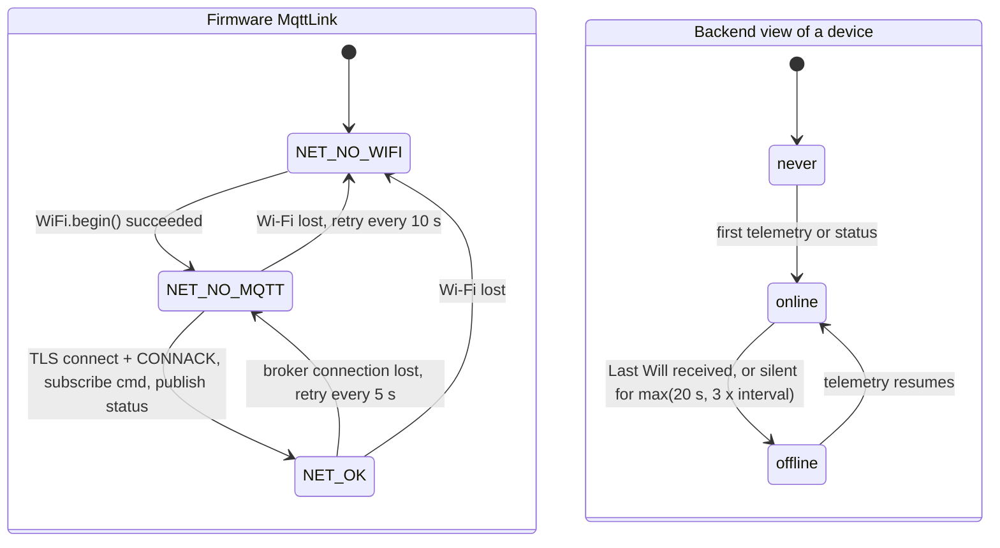

## 4. Activity diagrams

### 4.1 Firmware main loop

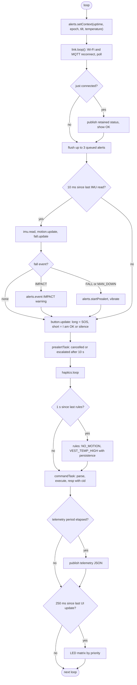

### 4.2 AI analysis of one telemetry message

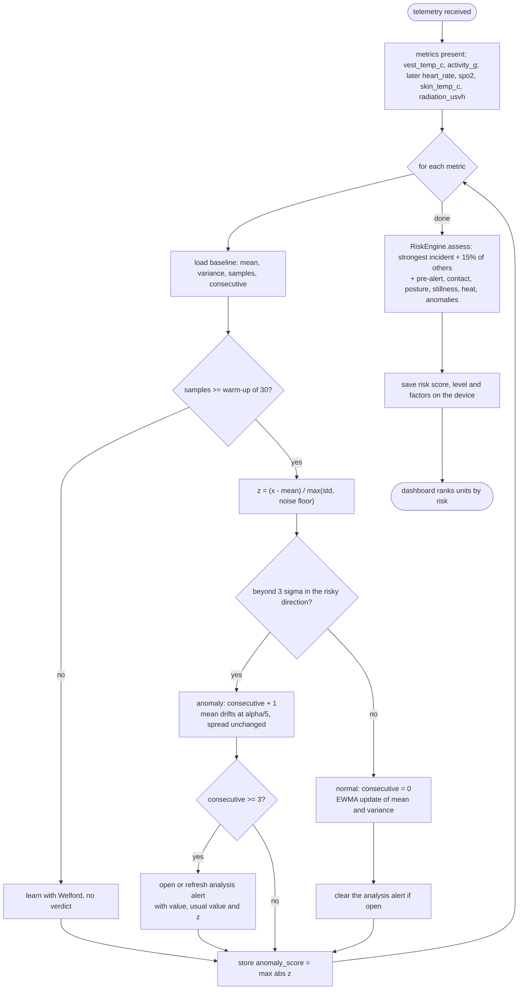
