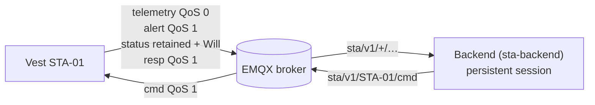

# MQTT protocol: vest ↔ backend (v1)

This is the contract between the vest firmware, the virtual vests in `tools/simulator` and the backend
gateway. These three must stay in step. Any change starts here.

| Item | Value |
|---|---|
| Protocol | MQTT 3.1.1 over TLS (port **8883**) |
| Broker | EMQX Cloud Serverless. Any MQTT 3.1.1 broker works: only host and credentials change |
| Authentication | Username and password **per client**. A vest's username is its `DEVICE_ID` (e.g. `STA-01`) |
| Topic root | `sta/v1` |
| Payload | Compact JSON object, UTF-8 |
| Time | `ts` = Unix epoch seconds (UTC), once the vest has synchronised its clock. `up` = seconds since boot |

## 1. Topics

Every topic is `sta/v1/<DEVICE_ID>/<channel>`. `DEVICE_ID` uses 2–32 characters from `A–Z a–z 0–9 _ -`.

| Channel | Direction | QoS | Retained | When |
|---|---|---|---|---|
| `telemetry` | vest → backend | 0 | no | Every 5 s by default. The ops room can set 1–60 s |
| `alert` | vest → backend | 1 | no | On every alert transition, plus a reminder every 30 s while a condition lasts |
| `status` | vest → backend | 1 | **yes** | On connect, after a settings change, and as the **Last Will** |
| `resp` | vest → backend | 1 | no | One answer for every command |
| `cmd` | backend → vest | 1 | no | Commands from the operations room |

**Backend subscriptions:** `sta/v1/+/telemetry` (QoS 0) and `sta/v1/+/alert`, `sta/v1/+/status`,
`sta/v1/+/resp` (QoS 1). The client id is fixed (`sta-backend`) with a **persistent session**
(`clean_session = false`), so the broker queues QoS 1 alerts while the backend restarts or sleeps.

**Vest subscription:** `sta/v1/<DEVICE_ID>/cmd` (QoS 1).



## 2. Telemetry: `sta/v1/<id>/telemetry`

The UNO R4 WiFi with an MPU-6050 and a MAX30102 sends this:

```json
{"id":"STA-01","seq":412,"up":2061,"ts":1794432203,"vest_t":33.4,
 "imu":{"peak_g":1.02,"tilt":3,"act":0.012,"posture":"upright","still_s":0},
 "vit":{"contact":true,"hr":74,"spo2":97},
 "rssi":-58,"alerts":0,"pre":false}
```

`vit` is present only when a MAX30102 was found at power-on. `hr` and `spo2` are left out until they
are measured (about 10 s after a finger is placed) and while nothing touches the sensor (`contact: false`).
With `SIMULATE_VITALS 1` and no MAX30102, the vest sends demo values instead, marked `"sim": true`, and its
status message reports `"ppg": "simulated"` so the dashboard can label them.

Later phases add more optional sections. The backend already accepts and stores them:

```json
{"vit":{"hr":82,"spo2":97,"skin_t":36.4,"contact":true},
 "gps":{"fix":true,"lat":24.7136,"lon":46.6753,"sat":9},
 "rad":{"usvh":0.12,"cpm":21,"dose":3.4},
 "bat":{"pct":76,"v":3.92}}
```

| Field | Unit | Accepted range | Meaning |
|---|---|---|---|
| `id` | | must equal the topic's device | Rejected if it differs |
| `seq` | | 0 – 2³¹ | Message counter since boot |
| `up` | s | 0 – 2³¹ | Uptime |
| `ts` | epoch s | 2020 – 2100 | Device clock (NTP). Omitted until synchronised |
| `vest_t` | °C | −40 – 125 | MPU-6050 die temperature: **vest or environment, not body** |
| `imu.peak_g` | g | 0 – 16 | Highest acceleration since the last message |
| `imu.tilt` | ° | 0 – 180 | Torso angle from the calibrated upright pose |
| `imu.act` | g | 0 – 16 | Activity: mean deviation from 1 g |
| `imu.posture` | | `upright`, `bent`, `lying`, `unknown` | |
| `imu.still_s` | s | ≥ 0 | How long the wearer has been still |
| `rssi` | dBm | −127 – 0 | Wi-Fi signal |
| `alerts` | bitmask | | Conditions active on the vest, see [§ 4](#4-alert-bitmask) |
| `pre` | bool | | A pre-alert is waiting for the wearer's answer |
| `vit.hr` / `vit.spo2` | bpm / % | 20–250 / 50–100 | MAX30102 heart rate and blood oxygen |
| `vit.skin_t` | °C | −10–60 | Phase 2 (MAX30205) |
| `vit.contact` | bool | | The MAX30102 is covered by a finger or skin |
| `gps.fix`, `gps.lat`, `gps.lon`, `gps.sat` | | WGS-84 | Phase 3. Position is ignored when `fix` is `false` |
| `rad.usvh` / `rad.cpm` / `rad.dose` | µSv/h / counts per minute / µSv | ≥ 0 | Phase 4 |
| `bat.pct` / `bat.v` | % / V | 0–100 / 0–60 | Phase 2 |

The backend treats a value that is missing, out of range or not a number as *absent* (`null`). It never
stores a made-up value. Unknown fields are ignored, so newer firmware can add fields without breaking an
older backend.

## 3. Alerts: `sta/v1/<id>/alert`

```json
{"id":"STA-01","seq":17,"type":"FALL","sev":3,"state":"event","val":3.41,
 "up":2068,"ts":1794432210,"tilt":78,"vest_t":33.5}
```

| Field | Meaning |
|---|---|
| `type` | Alert type from the catalogue in the [API reference](04-api-reference.md#alert-types) (device types only) |
| `sev` | `1` info, `2` warning, `3` critical |
| `state` | `pending`, `event`, `active`, `cleared` or `cancelled`. See below |
| `val` | Measured value: peak g for falls and impacts, seconds for no-motion, °C for heat |
| `seq` + `up` | Together they identify the message, so the backend drops duplicates |
| `tilt`, `vest_t`, `hr`, `spo2`, `lat`, `lon`, `usvh` | Optional context, shown on the incident |

The `state` values follow three patterns:

| Pattern | Used by | Sequence |
|---|---|---|
| **Pre-alert** | `FALL`, `MAN_DOWN` | `pending` (sev 1, wearer has 10 s) → `cancelled` (short press) **or** `event` (sev 3, nobody answered) |
| **One-off event** | `SOS`, `IMPACT` | `event` |
| **Condition** | `NO_MOTION`, `VEST_TEMP_HIGH`, `HR_HIGH`, `HR_LOW`, `SPO2_LOW` and the Phase 2–4 thresholds | `active` (repeated every 30 s, severity may change) → `cleared` |

An SOS while a pre-alert is waiting escalates that pre-alert at once.

**Store and forward.** If the vest is offline, up to 16 alert messages wait in its outbox and are sent
in order after it reconnects. The backend uses `ts`, or the boot time plus `up`, to place a replayed
event at the time it really happened.

## 4. Alert bitmask

`alerts` in telemetry is a bitmask of the conditions currently active on the vest. The bit order is fixed
and shared with the backend (`DEVICE_ALERT_BITS`) and the firmware (`AlertTypes.h`).

| Bit | Type | Bit | Type |
|---|---|---|---|
| 0 | `SOS` | 8 | `SKIN_TEMP_HIGH` |
| 1 | `FALL` | 9 | `SKIN_TEMP_LOW` |
| 2 | `IMPACT` | 10 | `RAD_RATE` |
| 3 | `MAN_DOWN` | 11 | `RAD_DOSE` |
| 4 | `NO_MOTION` | 12 | `SENSOR_OFF` |
| 5 | `HR_HIGH` | 13 | `BATTERY_LOW` |
| 6 | `HR_LOW` | 14 | `GPS_LOST` |
| 7 | `SPO2_LOW` | 15 | `VEST_TEMP_HIGH` |

Example: `"alerts": 32784` = bit 4 + bit 15 = `NO_MOTION` + `VEST_TEMP_HIGH`.

## 5. Status and Last Will: `sta/v1/<id>/status` (retained)

The vest publishes this on every (re)connect and after `interval` or `silent` changes it:

```json
{"id":"STA-01","online":true,"fw":"2.1.0","ip":"192.168.1.23","rssi":-58,
 "sensors":{"imu":"MPU-6050","ppg":true,"temp":false,"gps":false,"geiger":false,"bat":false},
 "interval_s":5,"buzzer":true}
```

`sensors.ppg` is `true` when the vest found a MAX30102 at power-on, and `"simulated"` when it sends demo
vitals instead (`SIMULATE_VITALS 1`).

The vest registers this **Last Will** with the broker when it connects. The broker publishes it if the
vest disappears without a clean disconnect (power loss, Wi-Fi gone):

```json
{"id":"STA-01","online":false}
```

Because the message is retained, the backend learns every vest's current state as soon as it
subscribes. Retained copies do not count as "seen now": only live messages refresh `last_seen_at`. The
simulator adds `"sim": true` so that a virtual vest registers as simulated.

## 6. Commands: `sta/v1/<id>/cmd`

```json
{"cmd":"interval","cid":"447cb632","sec":2}
```

| `cmd` | Extra fields | Vest action | `info` in the reply |
|---|---|---|---|
| `ping` | | Reply only | `pong` |
| `ack` | `type` (optional) | "Help is coming": OK on the LED matrix and two short buzzes | the alert type |
| `evac` | | Urgent evacuation pattern | |
| `stop` | | Stop buzzer and vibration | |
| `interval` | `sec` 1–60 | Change the telemetry period | `sec must be 1..60` when invalid |
| `silent` | `on` bool | Mute (`true`) or unmute the buzzer | `buzzer off` / `buzzer on` |
| `calibrate` | | Take the current pose as upright | `upright reference updated` |
| `status` | | Re-publish the status message | |

`cid` is a correlation id, 8 hex characters, created by the backend for each command.

## 7. Responses: `sta/v1/<id>/resp`

```json
{"id":"STA-01","cmd":"interval","ok":true,"info":"","up":2075,"cid":"447cb632"}
```

The backend matches the reply by `cid`. If `cid` is absent, it uses the latest open command of that
type. Malformed JSON gets `{"cmd":"?","ok":false,"info":"bad json"}`, and an unknown command gets
`"info":"unknown command"`.

## 8. Delivery guarantees

| Concern | How it is handled |
|---|---|
| Alerts must not be lost | QoS 1 end to end, a persistent backend session, the vest outbox (16) and dedup by `seq` + `up` |
| Telemetry volume | QoS 0, 5 s default. Only the newest reading matters; one missed sample is harmless |
| Vest vanishes | Retained Last Will → `offline` at once. Silence beyond max(20 s, 3 × interval) → `offline`. Beyond 60 s → `CONTACT_LOST` incident |
| Command delivery | QoS 1. The reply carries `cid`. No reply within 30 s → `timeout` |
| Clock | NTP through the Wi-Fi module. Before synchronisation, `ts` is omitted and the backend uses the boot time plus `up` |

## 9. Security rules

* TLS only. EMQX Serverless does not accept plain MQTT.
* One username per vest, with an ACL that limits it to `sta/v1/<its id>/…`. See
  [EMQX setup](07-setup-emqx.md#4-authorization-acl-recommended).
* The backend validates every message: the `id` must match the topic, numbers must be within physical
  ranges, and only device alert types are accepted from vests. Messages from unregistered or retired vests
  are dropped unless `DEVICE_AUTO_REGISTER=true`.
* Credentials live in `arduino_secrets.h` and `.env` files, which are git-ignored, or in Render
  environment variables. They are never in the repository.

## 10. Bandwidth budget

A Phase 1 telemetry message is about 170 bytes of JSON. Counting MQTT framing and delivery to the backend,
one vest at the 5 s default uses roughly **250 MB per month**. The EMQX free tier is 1 GB per month:
enough for one or two real vests around the clock, plus simulator demos of a few hours. For a long run of
the five virtual vests, raise their interval with `--interval 10` or more, or stop them after the demo.

## 11. Watching the traffic

Install [MQTTX](https://mqttx.app), EMQX's free desktop client. Connect with the `sta-backend` or
`sta-simulator` credentials (TLS, port 8883) and subscribe to `sta/v1/#` to see every message live. You can
also publish a command by hand, for example to `sta/v1/STA-01/cmd`:

```json
{"cmd":"ping","cid":"manual01"}
```

The vest replies on `sta/v1/STA-01/resp`.

## 12. Changing the protocol

* **Additive changes** (a new optional field, alert type or command) keep `sta/v1`. Update the firmware,
  the simulator, the backend parser and this page in the same pull request.
* **Breaking changes** (renamed fields, different meaning) move to `sta/v2`. The backend can subscribe to
  both while vests are re-flashed.
