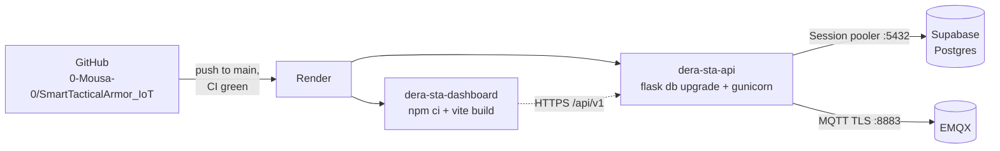

# Deploying to Render

Render hosts both halves of the system from this repository. `render.yaml` at the repository root is a
**Blueprint**: Render reads it and creates everything in one step.

| Service | Type (free plan) | What it runs |
|---|---|---|
| `dera-sta-api` | Web service, Python, Frankfurt | Flask API, MQTT ingestion and the housekeeping thread (gunicorn, 1 worker) |
| `dera-sta-dashboard` | Static site (global CDN) | The React dashboard, built with Vite |



## Before you start

| You need | From |
|---|---|
| The repository pushed to GitHub under `0-Mousa-0` | Main README: *Push to GitHub* |
| Supabase **Session pooler URI** | [Supabase setup](06-setup-supabase.md), step 2 |
| EMQX **address** and the **`sta-backend` password** | [EMQX setup](07-setup-emqx.md), steps 2–3 |
| An email and a strong password for the first administrator | You choose |

## 1. Create the Blueprint

1. Sign in at <https://dashboard.render.com> with **GitHub**, and allow Render to access the repository.
2. **New → Blueprint** → select the repository → branch `main`.
3. Render lists the two services from `render.yaml` and asks for the values marked `sync: false`.
   Fill them in:

| Service | Variable | Value |
|---|---|---|
| dera-sta-api | `DATABASE_URL` | The Supabase Session pooler URI, password included |
| dera-sta-api | `CORS_ORIGINS` | `https://dera-sta-dashboard.onrender.com` |
| dera-sta-api | `BOOTSTRAP_ADMIN_EMAIL` | Your administrator email |
| dera-sta-api | `BOOTSTRAP_ADMIN_PASSWORD` | A strong password, at least 8 characters |
| dera-sta-api | `MQTT_HOST` | The EMQX address, for example `ab12cd34.ala.eu-central-1.emqxsl.com` |
| dera-sta-api | `MQTT_PASSWORD` | The `sta-backend` password |
| dera-sta-dashboard | `VITE_API_BASE_URL` | `https://dera-sta-api.onrender.com/api/v1` |

`SECRET_KEY` is generated by Render. Everything else is already set in `render.yaml`, including
`PUBLIC_ACCESS_ROLE=admin`: the dashboard opens **without a sign-in page** and every visitor has
administrator rights. Use `operator` (incidents and vest commands, no fleet or account changes) or
`viewer` (read only) to give visitors less, or delete the variable to require sign-in again. The API
reads it at start-up, so change it in **Environment** and let the service restart.

4. Click **Apply**. Render builds both services. The first API build takes about 3 minutes, and the
   dashboard about 2.

> **Service URLs.** Render derives each URL from the service name. If a name is already taken, it adds a
> suffix, for example `dera-sta-api-x7k2.onrender.com`. When the services are created, check both URLs.
> If they differ from the table, update `CORS_ORIGINS` (API) and `VITE_API_BASE_URL` (dashboard). Then
> redeploy the dashboard: Vite writes the API address into the build, so the dashboard must be rebuilt.

## 2. Watch the first deploy

In **dera-sta-api → Logs** you should see:

```
INFO  [alembic.runtime.migration] Running upgrade  -> 0001_initial, initial schema
INFO  [alembic.runtime.migration] Running upgrade 0001_initial -> 0002_enable_rls, …
[INFO] Booting worker with pid: …
INFO app.runtime: bootstrap administrator created from environment variables
INFO app.messaging.mqtt_gateway: MQTT gateway connecting to ab12cd34.ala.eu-central-1.emqxsl.com:8883
INFO app.messaging.mqtt_gateway: MQTT connected (session present: False)
```

Migrations run on every start (`flask db upgrade` in `startCommand`) and do nothing if the schema is
already current. The free plan has no separate pre-deploy step, so this is where they run.

## 3. Check that it works

1. Open `https://dera-sta-api.onrender.com/api/v1/health`:

   ```json
   {"status": "ok", "database": "ok", "mqtt": {"enabled": true, "connected": true}, "version": "1.0.0", "time": "…"}
   ```

2. Open `https://dera-sta-dashboard.onrender.com`. With `PUBLIC_ACCESS_ROLE` set it opens directly on
   the command overview; without it, sign in with the bootstrap administrator.
3. If you use sign-in, go to **Settings** and change the password. The bootstrap values are used only
   when no administrator exists, so changing the password, or later removing the variables, is safe.
4. Load the demo fleet if you have not already done it locally against Supabase:

   ```powershell
   cd backend; .\.venv\Scripts\Activate.ps1
   flask --app wsgi seed-demo          # with DATABASE_URL in backend/.env = the Supabase URI
   ```

   Alternatively, register `STA-01` on the **Fleet** page and assign a wearer.
5. Power the vest, or start the simulator. Units turn **online** on the overview within a few seconds.

## 4. Continuous deployment

* Both services use `autoDeployTrigger: checksPass`. A push to `main` deploys **only after the GitHub
  Actions CI passes** (backend, frontend, firmware). A red build never reaches production.
* The API has `rootDir: backend`, so only changes under `backend/` redeploy it. The dashboard has a
  `frontend/**` build filter. Changes to documentation alone redeploy nothing.
* **Manual Deploy → Deploy latest commit** redeploys at any time. **Rollback** on an earlier deploy
  restores it.
* Variables marked `sync: false` are asked for only when the Blueprint is created. Change them later in
  each service's **Environment** tab. A change to `VITE_API_BASE_URL` needs a dashboard redeploy.

## 5. Free plan behaviour

| Behaviour | Effect | What to do |
|---|---|---|
| The API **sleeps after 15 minutes** without HTTP requests | Telemetry is not processed while it sleeps. The first request wakes it in about a minute | Open the dashboard a minute before a demo. An open dashboard keeps the API awake, because it polls every few seconds |
| MQTT while asleep | The broker keeps the backend's persistent session and queues **QoS 1 alerts**, which are processed on wake-up. QoS 0 telemetry from that time is skipped | By design: alerts are not lost; only the live trace has a gap |
| 750 free instance hours per month | One always-on web service uses about 744 | Keep a single free web service in the workspace |
| Optional: stay awake | An uptime monitor such as UptimeRobot calling `/api/v1/health` every 5 minutes prevents sleeping | Within the 750 h. For real operations use the Starter plan (always on) |

## 6. Troubleshooting

| Symptom | Cause and fix |
|---|---|
| Deploy fails: `DATABASE_URL is not set` / `SECRET_KEY is not set` | Production refuses unsafe defaults. Set the variable on the API's **Environment** tab |
| Deploy fails at `flask db upgrade` | Wrong `DATABASE_URL`. See [Supabase troubleshooting](06-setup-supabase.md#7-troubleshooting) |
| Health check fails | Read the Logs tab. The health check calls `/api/v1/health`, which returns 503 while the database is unreachable |
| Dashboard shows "network error" and the browser console mentions CORS | `CORS_ORIGINS` must exactly equal the dashboard's address: `https://…onrender.com`, with no trailing `/` |
| Dashboard calls `localhost:5000` | `VITE_API_BASE_URL` was missing at build time. Set it and redeploy the dashboard |
| A page refresh gives 404 | The SPA rewrite rule (`/*` → `/index.html`) is in `render.yaml`. Re-sync the Blueprint if it was removed |
| `mqtt.connected` is `false` | Check `MQTT_HOST` and `MQTT_PASSWORD`, and the ACL for `sta-backend`. See [EMQX troubleshooting](07-setup-emqx.md#8-troubleshooting) |
| Units go offline every few minutes | Two backends use the broker with the same client id. Stop the local one, or run it with `MQTT_ENABLED=false` |
