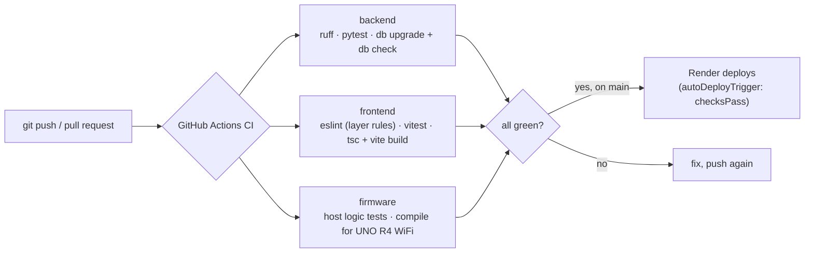

# Source control, configuration management and quality assurance

This page explains how the project is versioned, configured, tested and released, so that every
change follows the same path from a commit to production.

## 1. Repository layout

```
SmartTacticalArmor_IoT/
├── backend/        Flask n-tier API: api → facade → services / persistence → models   (Python 3.12)
├── frontend/       React + TypeScript dashboard, clean architecture per feature         (Node 24)
├── firmware/       UNO R4 WiFi + MPU-6050 vest firmware, host unit tests               (C++ / Arduino)
├── tools/
│   ├── simulator/  virtual vests that speak the real MQTT protocol
│   └── e2e/        local broker + end-to-end checker
├── docs/           plan, UML, API, protocol, setup guides, this page
├── legacy/         the first prototype, kept read-only for reference
├── render.yaml     Render Blueprint (production infrastructure as code)
└── .github/workflows/ci.yml
```

## 2. Branching and commits

* **Trunk-based.** `main` is always deployable. Work happens on short-lived branches (`feat/…`, `fix/…`,
  `docs/…`) that merge through a pull request once CI is green.
* **Recommended GitHub setting:** *Settings → Branches → Add rule* for `main` with **Require status checks
  to pass** (the three CI jobs) and **Require a pull request before merging**.
* **Conventional Commits** keep the history readable and release notes easy to write:

  | Prefix | Use for | Example from this repository |
  |---|---|---|
  | `feat(scope)` | New behaviour | `feat(backend): Flask n-tier command & control API on Supabase Postgres` |
  | `fix(scope)` | Bug fix | `fix(backend): two defects found by the end-to-end MQTT test run` |
  | `docs`, `test`, `ci`, `chore`, `refactor` | Everything else | `chore: repository scaffold and archived v1 firmware` |

  Scopes: `backend`, `frontend`, `firmware`, `tools`, `docs`, `deploy`.

## 3. Versioning

| Artifact | Version | Where it is set | Rule |
|---|---|---|---|
| Backend API | `1.0.0` | `API_VERSION` in `backend/app/config.py`, shown by `/health` | SemVer |
| REST contract | `/api/v1` | URL prefix | A breaking change gets a new prefix |
| MQTT contract | `sta/v1` | Topic root | See [MQTT protocol § 12](05-mqtt-protocol.md#12-changing-the-protocol) |
| Firmware | `2.0.0` | `FW_VERSION` in `config.h`, reported in the status message | SemVer. `1.x` is the archived prototype |
| Database schema | Alembic revision (`0002_enable_rls`) | `backend/migrations/versions/` | Forward-only, one revision per change |

Releases are tagged on `main` (`git tag -a v1.0.0 -m "…"`, then `git push --tags`).

## 4. Configuration and secrets

Settings are environment variables, and secrets never enter git.

| Component | Committed template | Real values (git-ignored) | Production |
|---|---|---|---|
| Backend | `backend/.env.example` | `backend/.env` | Render environment (`render.yaml`, `sync: false` for secrets) |
| Dashboard | `frontend/.env.example` | `frontend/.env.local` | Render environment (`VITE_API_BASE_URL`) |
| Firmware | `arduino_secrets.example.h`, `config.h` | `arduino_secrets.h` | Flashed into the vest |
| Simulator | `tools/simulator/.env.example` | `tools/simulator/.env` | Run on a laptop |

Safeguards:

* `.gitignore` covers `.env`, `.env.*` (except the examples), `**/arduino_secrets.h` and local databases.
* The backend **refuses to start in production** with the development `SECRET_KEY` or without
  `DATABASE_URL`. `backend/tests/test_config.py` covers this.
* Stage files by explicit path, never with `git add -A`, and read `git diff --staged` for secrets before
  committing.

## 5. Database change management

Every schema change goes through **Alembic** (Flask-Migrate):

```powershell
cd backend
# 1. change a model in app/models/
flask --app wsgi db migrate -m "add battery_temp_c to telemetry"   # generates a revision
# 2. read and edit the generated file in migrations/versions/: autogenerate is a draft
flask --app wsgi db upgrade                                          # apply locally
pytest                                                               # suite still green
flask --app wsgi db check                                            # models and migrations agree
```

CI runs `db upgrade` followed by `db check` on every push, so a model change without a migration fails the
build. Production applies pending migrations automatically when the API starts. The schema is portable:
the same migrations run on SQLite (tests) and PostgreSQL (Supabase), and PostgreSQL-only statements
such as row-level security are skipped on SQLite.

## 6. Continuous integration and delivery



| Job | Checks | Fails when |
|---|---|---|
| backend | `ruff check`, `pytest` (SQLite), `flask db upgrade && flask db check` | Lint error, failing test, model/migration drift |
| frontend | `eslint` (including architecture layer rules), `vitest`, `tsc -b`, `vite build` | Lint or type error, a layer rule broken, failing test, build error |
| firmware | `run_tests.sh` (49 checks), `arduino/compile-sketches` for `arduino:renesas_uno:unor4wifi` | Logic regression, compile error |

## 7. Test strategy

| Level | Tool | What it proves | Size | Run it |
|---|---|---|---|---|
| Unit: analysis | pytest | Baseline learning, z-score, persistence, risk, priority, shielding maths | part of 69 | `cd backend && pytest tests/test_analysis.py` |
| Unit: protocol | pytest | Every MQTT payload is validated and bounded; bad input is rejected | part of 69 | `pytest tests/test_payloads.py` |
| Integration: ingestion | pytest + SQLite | Telemetry → AI → incidents → risk, in one transaction per message | part of 69 | `pytest tests/test_ingest_flow.py` |
| Integration: commands | pytest | Correlation ids, timeouts, the reply-before-sent race | part of 69 | `pytest tests/test_commands.py` |
| API and security | pytest + Flask test client | Every endpoint, role checks (401 / 403), validation errors | part of 69 | `pytest tests/test_api.py` |
| Configuration | pytest | Production refuses unsafe settings; URL normalisation | part of 69 | `pytest tests/test_config.py` |
| Same suite on PostgreSQL | pytest | Types, JSONB and constraints behave the same on Postgres | 69 | `TEST_DATABASE_URL=postgresql://… pytest` |
| Frontend unit and component | Vitest + Testing Library | HTTP client and errors, i18n, domain mapping, login flow | 17 | `cd frontend && npm test` |
| Firmware logic | g++ / clang++ / zig on a PC | Fall state machine, motion maths, alert manager, outbox, button | 49 checks | `firmware/test/run_tests.sh` |
| Firmware build | arduino-cli | Compiles for the real board without warnings | 1 | CI, or `arduino-cli compile` |
| End to end | aedes broker + simulator + checker | The whole chain over real MQTT, as the dashboard uses it | 18 checks | [tools/e2e/README.md](../tools/e2e/README.md) |
| Visual QA | Headless browser screenshots | Every page in Arabic (RTL) and English, desktop and phone | 14 views | Manual review |
| Hardware acceptance | The vest itself | Demo moves in [firmware/README.md § 5](../firmware/README.md#5-demo-moves-phase-1) | 8 moves | Manual |

## 8. Defects found before release

Every defect gets a regression test before it is fixed.

| # | Defect | Found by | Fix | Regression test |
|---|---|---|---|---|
| 1 | An AI alert cleared itself during a sustained abnormal rise: anomalous samples widened the baseline's variance | End-to-end run 1 | Anomalous samples only nudge the mean and never widen the variance | `test_sustained_shift_stays_anomalous_then_becomes_the_new_normal` |
| 2 | A fast vest reply arrived before the API had marked the command `sent`, and was lost | End-to-end run 2 | Replies are accepted while `queued`, and a completed status is never overwritten | `test_reply_that_beats_the_send_confirmation_is_not_lost` |
| 3 | The firmware chose `FALL` or `MAN_DOWN` by peak g instead of by the event's origin | Code review with host tests | The fall detector's event decides | `firmware/test/test_logic.cpp` |
| 4 | Lower-case blood types (`o+`) were rejected by the API schema | API tests | Validated case-insensitively by the model's validator | `tests/test_api.py` |
| 5 | Autogenerated migrations referenced application-only column types | `flask db check` | `render_item` hook emits portable SQLAlchemy types | CI `db check` |
| 6 | Map tiles needed an API key; tooltips and number order broke in RTL; topbar wrapped on phones | Visual QA | OpenStreetMap tiles with a dark filter; RTL-aware components | Screenshots |

## 9. Definition of done

A change is done when:

1. It is covered by tests at the right level, including a regression test for a bug.
2. CI is green: lint, types, tests, migrations and the firmware build.
3. The protocol, API or setup documentation is updated in the same pull request when behaviour changes.
4. No secret is in the diff, and new settings have a placeholder in the matching `.env.example`.
5. User-facing text exists in **both** Arabic and English. The type-checked i18n keys make a missing
   translation a build error.
6. For dashboard changes, the page was checked in both languages and at phone width.
