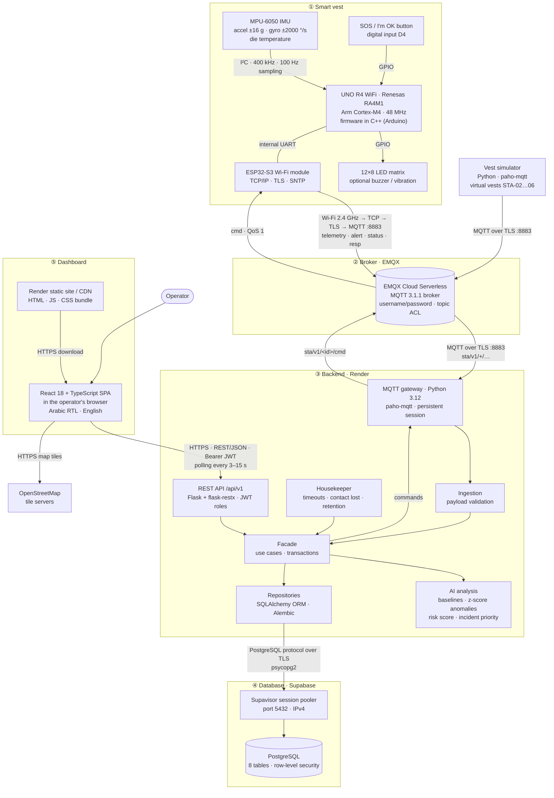
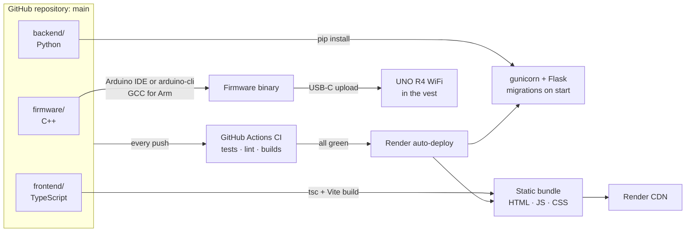

# Technical overview: end to end

This document describes the whole technical system of **Dera (Smart Tactical Armor)**, from the sensor on
the vest to the operator's screen. It covers the end-to-end block diagram, the protocol used on every link,
and the languages, frameworks, libraries, hardware and cloud services the system is built with.

For more depth: [structural UML](02-uml-structural.md) · [behavioral UML](03-uml-behavioral.md) ·
[REST API](04-api-reference.md) · [MQTT protocol](05-mqtt-protocol.md).

## Contents
1. [The system at a glance](#1-the-system-at-a-glance)
2. [End-to-end block diagram](#2-end-to-end-block-diagram)
3. [How data moves through the system](#3-how-data-moves-through-the-system)
4. [Protocols](#4-protocols)
5. [Programming languages](#5-programming-languages)
6. [Frameworks and libraries](#6-frameworks-and-libraries)
7. [Hardware](#7-hardware)
8. [Cloud services and hosting](#8-cloud-services-and-hosting)
9. [Data formats and conventions](#9-data-formats-and-conventions)
10. [Security along the chain](#10-security-along-the-chain)
11. [Timing and capacity](#11-timing-and-capacity)
12. [From source code to running system](#12-from-source-code-to-running-system)

---

## 1. The system at a glance

The system has five blocks connected in a chain:

| # | Block | Runs on | Built with | Job |
|---|---|---|---|---|
| ① | **Smart vest** | Arduino UNO R4 WiFi + MPU-6050 | C++ (Arduino) | Senses motion and temperature, detects falls, impacts and inactivity, handles the SOS button, reports over MQTT |
| ② | **Message broker** | EMQX Cloud Serverless | (managed service) | Relays messages between vests and the backend, enforces credentials and topic permissions |
| ③ | **Backend** | Render web service | Python 3.12, Flask | Ingests and validates messages, runs the AI analysis, stores data, serves the REST API, sends commands |
| ④ | **Database** | Supabase | PostgreSQL | Stores operators, personnel, vests, telemetry, incidents, commands and AI baselines |
| ⑤ | **Dashboard** | Render static site (CDN) + the operator's browser | TypeScript, React | The operations room: live units, map, prioritized incidents, AI analysis, commands |

The **vest simulator** (Python) can stand in for extra vests. It speaks exactly the same protocol as the
real firmware.

## 2. End-to-end block diagram

**Reading the diagram:** data flows down, from the vest through the broker into the backend and then the
database. The dashboard pulls it over HTTPS. Commands flow back up: dashboard → REST API → backend →
broker → vest.

## 3. How data moves through the system

### 3.1 A telemetry reading (every 5 s)

1. The firmware samples the MPU-6050 over **I²C** 100 times a second and computes tilt, posture, activity,
   peak acceleration and stillness.
2. Every 5 s it builds a compact **JSON** message (about 170 bytes) with ArduinoJson.
3. The ESP32-S3 module sends it over **Wi-Fi**, **TCP** and **TLS** as an **MQTT PUBLISH** to
   `sta/v1/STA-01/telemetry` (QoS 0).
4. EMQX checks the vest's credentials and topic permission, then forwards the message to the backend's
   subscription `sta/v1/+/telemetry`.
5. The backend's MQTT gateway (paho-mqtt) hands it to the dispatcher. The ingestion layer validates every
   field, checks its range and drops anything implausible.
6. In **one database transaction**, the facade:
   * updates the vest's live state ("last seen", latest values);
   * runs the **AI**: it compares each value with the wearer's own learned baseline (z-score) and raises
     or clears an analysis incident;
   * stores a history row (at most one every 5 s);
   * recomputes the vest's **risk score** (0–100) and the reasons for it.
7. SQLAlchemy sends the SQL through **psycopg2** over the **PostgreSQL wire protocol with TLS** to
   Supabase's session pooler.
8. The open dashboard polls `GET /api/v1/devices/{id}` (every 3 s on the unit page) over **HTTPS**, with
   a **JWT** in the `Authorization` header, and React re-renders the sensor tiles, risk and charts.

### 3.2 An alert (fall)

1. The firmware's fall detector sees free fall, then an impact, then the wearer lying for 2.5 s.
2. The vest publishes `FALL` with state `pending` on `sta/v1/STA-01/alert` (**QoS 1**) and blinks "!" on the
   LED matrix: the wearer has 10 s to press "I'm OK".
3. With no answer, it publishes `FALL` with state `event` and severity critical. If the vest is offline,
   the alert waits in its outbox (up to 16 messages) and is sent when the connection returns.
4. The backend opens or escalates the incident, ranks it by priority and raises the risk score. The
   dashboard shows it at the top of the queue within one polling cycle.

### 3.3 A command (operator → vest)

1. The operator clicks **Acknowledge** (or a command button). The browser sends `POST` over HTTPS.
2. The API checks the role, stores the command with a **correlation id** (`cid`) and publishes it to
   `sta/v1/STA-01/cmd` (**QoS 1**).
3. The vest executes it (for `ack`: "OK" on the LED matrix and a short buzz) and replies on
   `sta/v1/STA-01/resp` with the same `cid`.
4. The backend matches the reply and marks the command `acknowledged`. Without a reply within 30 s, it
   marks it `timeout`.

### 3.4 Losing a vest

When it connects, the vest registers a **Last Will** message with the broker. If power or Wi-Fi is lost,
the broker publishes `{"online": false}` on the vest's retained `status` topic. The backend marks the vest
offline at once and raises `CONTACT_LOST` after 60 s of silence. Both clear automatically when it returns.

## 4. Protocols

### 4.1 Protocol on every link

| Link | Physical / network | Transport and security | Application protocol | Payload |
|---|---|---|---|---|
| MPU-6050 → RA4M1 | I²C bus, 400 kHz, address `0x68` | none (on-board wiring) | MPU-6050 register map | 14-byte burst: accel, temperature, gyro |
| Button → RA4M1 | GPIO, internal pull-up | none | debounced short press / 2 s hold | |
| RA4M1 ↔ ESP32-S3 | Internal UART on the board | none (on-board) | The WiFiS3 library's command protocol | |
| Vest → EMQX | Wi-Fi 802.11 b/g/n, 2.4 GHz, IPv4 | TCP, **TLS** (done by the ESP32-S3) | **MQTT 3.1.1**, port 8883 | JSON |
| Simulator → EMQX | Internet, IPv4 | TCP, TLS (certifi CA bundle) | MQTT 3.1.1, port 8883 | JSON |
| EMQX ↔ backend | Internet, IPv4 | TCP, TLS (certifi CA bundle) | MQTT 3.1.1, port 8883, persistent session | JSON |
| Vest clock | Wi-Fi | UDP | **SNTP**, through the Wi-Fi module (`WiFi.getTime()`) | Unix time |
| Backend → Supabase | Internet, IPv4 | TCP, TLS (`sslmode=require`) | **PostgreSQL wire protocol** via the Supavisor session pooler, port 5432 | SQL |
| Browser → dashboard host | Internet | TLS (HTTPS) | HTTP | HTML, JS, CSS |
| Browser → API | Internet | TLS (HTTPS, terminated by Render's proxy) | HTTP/1.1 **REST**, JSON, `Authorization: Bearer <JWT>` | JSON |
| Browser → map tiles | Internet | TLS (HTTPS) | HTTP | PNG tiles |
| GitHub → Render | Internet | HTTPS webhooks | Git + Render deploy hooks | |

### 4.2 MQTT in this system

| Feature | How it is used |
|---|---|
| Topics | `sta/v1/<DEVICE_ID>/<telemetry | alert | status | resp | cmd>` |
| QoS 0 | Telemetry: frequent, and only the newest value matters |
| QoS 1 | Alerts, status, command replies and commands: at-least-once delivery. The backend drops duplicates by message sequence and uptime |
| Retained message | `status`: anyone who subscribes learns each vest's last state at once |
| Last Will and Testament | `{"online": false}` on `status`: the broker reports a vest that vanishes |
| Persistent session | Backend client id `sta-backend`, `clean_session=false`: the broker queues QoS 1 messages while the backend restarts or sleeps |
| Keep-alive | 30 s (vest and backend) |
| Authentication and authorization | One username/password per client. The ACL limits each vest to its own topics |

Full message formats: [MQTT protocol](05-mqtt-protocol.md).

### 4.3 HTTP API

| Item | Value |
|---|---|
| Style | REST, resource URLs under `/api/v1`, JSON bodies, standard status codes |
| Authentication | `POST /auth/login` returns a **JWT** (HS256, 8 h). It is sent as `Authorization: Bearer …` |
| Authorization | Roles `viewer`, `operator` and `admin`, checked on every endpoint |
| Documentation | Swagger UI at `/api/v1/docs`, generated from the code by flask-restx |
| Cross-origin | CORS allows only the dashboard's origin (`CORS_ORIGINS`) |
| Live updates | The dashboard polls with TanStack Query every 3–15 s, depending on the page |

Endpoint list: [REST API reference](04-api-reference.md).

## 5. Programming languages

| Language | Version | Where it is used |
|---|---|---|
| **C++** | C++17 (GCC for Arm via the Arduino Renesas core; g++, clang++ or zig for host tests) | Vest firmware (`firmware/`), its unit tests |
| **Python** | 3.12 | Backend (`backend/`), simulator, end-to-end checker (`tools/`) |
| **TypeScript** (TSX) | 5.7 | Dashboard (`frontend/src/`) |
| **SQL** (PostgreSQL) | | Schema created by Alembic migrations; row-level security statements |
| **CSS** | CSS Modules + custom properties (design tokens) | Dashboard styling, dark map filter, RTL-aware layout |
| **HTML** | HTML5 | Dashboard shell (`index.html`) |
| **JavaScript** (Node.js 24) | ES2022 | Build tooling configuration, the local test broker (`tools/e2e/local_broker.js`) |
| **YAML** | | CI workflow (`.github/workflows/ci.yml`), Render Blueprint (`render.yaml`) |
| **JSON** | | Every MQTT and REST payload; package manifests |
| **Shell / PowerShell** | | Firmware test runners |
| **Markdown + Mermaid** | | Documentation and every diagram |

## 6. Frameworks and libraries

### 6.1 Vest firmware

| Library | Version | Purpose |
|---|---|---|
| Arduino core for UNO R4 (`arduino:renesas_uno`) | 1.6.0 | Board support, compiler, `Wire` (I²C) |
| WiFiS3 | bundled with the core | Wi-Fi, `WiFiSSLClient` (TLS), `WiFi.getTime()` (SNTP) |
| Arduino_LED_Matrix | bundled with the core | 12×8 LED matrix frames |
| ArduinoMqttClient | latest from the Library Manager | MQTT 3.1.1 client with Last Will |
| ArduinoJson | 7.x | JSON payload encoding and command parsing |
| Own modules | `firmware/SmartTacticalArmor/src/` | MPU-6050 driver, MotionAnalyzer, FallDetector, AlertManager, AlertOutbox, SosButton, MqttLink, StatusDisplay, Haptics |

### 6.2 Backend

| Library | Version | Purpose |
|---|---|---|
| Flask | 3.1.3 | Web framework |
| flask-restx | 1.3.2 | REST namespaces, request validation, Swagger UI |
| Flask-SQLAlchemy / SQLAlchemy | 3.1.1 / 2.1.8 | ORM |
| Flask-Migrate / Alembic | 4.1.0 / 1.20.1 | Database migrations |
| psycopg2-binary | 2.9.13 | PostgreSQL driver |
| paho-mqtt | 2.2.0 | MQTT client (gateway) |
| PyJWT | 2.15.1 | Session tokens (HS256) |
| flask-cors | 6.0.5 | Cross-origin rules |
| certifi | 2026.10.23 | Trusted root certificates for TLS |
| python-dotenv | 1.2.4 | `.env` loading in development |
| gunicorn | 27.0.0 | Production server: 1 worker, 8 threads |
| pytest / ruff | 9.2.0 / 0.17.4 | Tests / lint |

The AI analysis (Welford and EWMA baselines, z-scores, risk fusion, priority, Beer–Lambert shielding) is
written in plain Python with no ML framework. It is fully explainable and light enough for the free tier.

### 6.3 Dashboard

| Library | Version | Purpose |
|---|---|---|
| React / React DOM | 18.3.1 | UI library |
| React Router | 6.30.6 | Pages and navigation, lazy-loaded routes |
| TanStack Query | 5.107.1 | Server state, polling, caching |
| Leaflet / React Leaflet | 1.9.4 / 4.2.1 | Operational map (OpenStreetMap tiles) |
| Recharts | 2.15.4 | Trend charts |
| Vite / @vitejs/plugin-react | 6.4.6 / 4.7.0 | Development server and production build |
| TypeScript | 5.7.3 | Static typing, including type-checked translation keys |
| Vitest / Testing Library / jsdom | 3.2.7 / 16.3.3 / 25.0.1 | Unit and component tests |
| ESLint / typescript-eslint | 9.39.5 / 8.72.2 | Lint, including the clean-architecture layer rules |
| IBM Plex Sans Arabic, IBM Plex Mono | Google Fonts | Typography for Arabic and numbers |

The dashboard's own code is organised by feature, with each feature split into domain, data, application and presentation layers, plus a dependency-injection
container. Translations are built in (Arabic and English) without an i18n framework.

### 6.4 Tools

| Tool | Version | Purpose |
|---|---|---|
| Vest simulator | Python + paho-mqtt 2.2.0 | Virtual vests that speak the real protocol |
| aedes | 0.51.3 (Node.js) | Throwaway local MQTT broker for the end-to-end test |
| GitHub Actions | checkout v5, setup-python v6, setup-node v5, arduino/compile-sketches v1 | Continuous integration |
| arduino-cli / Arduino IDE | | Compiling and uploading the firmware |
| MQTTX | | Watching MQTT traffic by hand |

## 7. Hardware

| Part | Details | Role |
|---|---|---|
| **Arduino UNO R4 WiFi** | Renesas RA4M1 (Arm Cortex-M4F, 48 MHz, 256 KB flash, 32 KB RAM) and an ESP32-S3 Wi-Fi module | Main controller. The firmware uses 38 % of flash and 35 % of RAM |
| **MPU-6050** (GY-521 board) | 3-axis accelerometer (±16 g), 3-axis gyroscope (±2000 °/s), die temperature sensor. I²C at `0x68` | Falls, impacts, posture, activity, stillness, vest temperature |
| Push button | D4 to GND | SOS (hold 2 s), "I'm OK" (short press) |
| 12×8 LED matrix | On the board | Status for the wearer: connected, pre-alert, SOS, acknowledged |
| Buzzer, vibration motor | Optional, D6 / D5 through a transistor or MOSFET | Feedback for the wearer |
| **Later phases** | MAX30102 (heart rate, SpO₂), MAX30205 (skin temperature), GPS, Geiger counter, battery monitor | Already supported by the protocol, database and dashboard |

Vest layers (not electronic): Kevlar for ballistic protection, and a PMMA nanocomposite with Bi₂O₃ for
radiation shielding. Their lab data feeds the dashboard's armor page.

## 8. Cloud services and hosting

| Service | Plan | Region | Used for |
|---|---|---|---|
| **GitHub** | Free | | Source code, pull requests, GitHub Actions CI |
| **EMQX Cloud Serverless** | Free (1 GB traffic and 1 M session-minutes per month) | AWS eu-central-1 (Frankfurt) | MQTT broker |
| **Render** web service | Free (512 MB RAM, sleeps after 15 min idle) | Frankfurt | Backend API and MQTT ingestion |
| **Render** static site | Free (global CDN) | | Dashboard files |
| **Supabase** | Free (500 MB database) | Central EU (Frankfurt) | PostgreSQL |
| **OpenStreetMap** | Free tile service | | Map background |

Everything is defined as code where possible: `render.yaml` creates both Render services, Alembic
migrations create the database schema, and `.github/workflows/ci.yml` defines the CI pipeline.

## 9. Data formats and conventions

| Topic | Convention |
|---|---|
| Messages | Compact JSON on MQTT. JSON with `snake_case` fields on the REST API |
| Time | Vest: Unix epoch seconds (`ts`) and uptime (`up`). API and database: ISO 8601 in UTC. Dashboard: Asia/Riyadh time |
| Identifiers | UUIDs for database rows. `STA-01`-style codes for vests (also their MQTT username) |
| Units | °C, g (gravity), degrees, seconds, dBm, µSv/h |
| Missing data | `null`. A sensor that is not fitted never reports a fake value |
| Severity | Vest: `1`, `2` or `3`. API: `info`, `warning` or `critical` |
| Versions | REST `/api/v1`, MQTT `sta/v1`, firmware `2.0.0`, API `1.0.0` |

## 10. Security along the chain

| Hop | Protection |
|---|---|
| Vest ↔ broker | TLS encryption. A unique username and password per vest. An ACL ([EMQX setup § 4](07-setup-emqx.md#4-authorization-acl-recommended)) restricts each vest to its own topics. Credentials live only in the git-ignored `arduino_secrets.h` |
| Broker ↔ backend | TLS with certificate verification (certifi). A dedicated `sta-backend` account |
| Backend input | Every MQTT message is validated: the `id` must match the topic, values must be within physical ranges, and unknown vests are rejected |
| Browser ↔ API | HTTPS only. JWT sessions that expire after 8 h. Role checks on every endpoint. Login lockout after 5 failures. CORS limited to the dashboard |
| API ↔ database | TLS (`sslmode=require`). Credentials in environment variables. Row-level security closes Supabase's public Data API |
| Dashboard host | `X-Frame-Options: DENY`, strict referrer policy |
| Configuration | Secrets only in environment variables or git-ignored files. Production refuses to start with development defaults |

## 11. Timing and capacity

| Item | Value |
|---|---|
| IMU sampling | 100 Hz (every 10 ms) |
| Rule evaluation on the vest (no motion, heat) | Every 1 s |
| LED matrix refresh | Every 250 ms |
| Telemetry period | 5 s by default, 1–60 s by command |
| Fall pre-alert window | 10 s |
| SOS hold | 2 s |
| No-motion alert | After 60 s still |
| Reminder for an ongoing condition | Every 30 s |
| Vest offline (backend view) | Last Will at once, or silent for max(20 s, 3 × interval) |
| `CONTACT_LOST` incident | After 60 s without data |
| Command timeout | 30 s |
| Backend housekeeping | Every 15 s |
| Telemetry stored | At most every 5 s per vest. Kept for 7 days |
| Dashboard refresh | Every 3–15 s, depending on the page |
| Bandwidth | About 170 bytes per telemetry message, about 250 MB per vest per month at 5 s |

## 12. From source code to running system

| Component | Build | Delivery | Runs as |
|---|---|---|---|
| Firmware | Arduino toolchain (GCC for Arm) | USB upload from a laptop | Bare-metal loop on the RA4M1, no RTOS, cooperative scheduler |
| Backend | `pip install -r requirements.txt` | Render auto-deploy after CI passes | gunicorn, 1 worker with 8 threads. The same process holds the MQTT session and the housekeeping thread |
| Dashboard | `npm ci && npm run build` (tsc + Vite) | Render auto-deploy after CI passes | Static files on a CDN, run in the browser |
| Database schema | Alembic revisions | Applied automatically when the API starts | PostgreSQL on Supabase |
