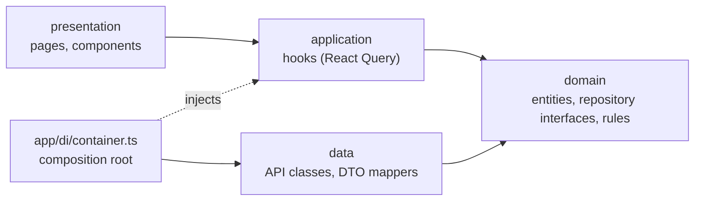

# Dashboard: React operations room

The dashboard is the operations room's single-page application, built with React 18, TypeScript and Vite.
Arabic (RTL) is the default language and English is one click away. Each page has one job:

| Route | Page | Purpose |
|---|---|---|
| `/` | Overview | KPIs, active incidents, AI priority queue, system status, mini map |
| `/map` | Operational map | Every unit on the Riyadh map, coloured by risk |
| `/units` | Field units | All vests, sorted by AI risk, filterable |
| `/units/:id` | Unit detail | Live sensors, risk explanation, trends, incidents, commands |
| `/alerts` | Alerts and incidents | Priority queue, filters, timeline, acknowledge or resolve |
| `/analysis` | AI analysis | Risk ranking, per-wearer baselines, how the model works |
| `/armor` | Armor and radiation shielding | Layer stack, lab data, Beer–Lambert calculator |
| `/fleet` | Devices and personnel | Register vests, assign wearers (admin) |
| `/settings` | Settings | Profile, password, operator accounts (admin) |

## Clean architecture

Each feature under `src/features/<name>/` has the same four layers. Dependencies point inwards only:



| Layer | Contains | May import |
|---|---|---|
| `domain/` | Entities (`Unit`, `Alert`, …), repository **interfaces**, pure rules | Nothing framework-specific: no React, no HTTP |
| `data/` | `UnitApi implements UnitRepository`, DTO → entity mappers | `domain`, `core/http` |
| `application/` | Hooks such as `useUnit(id)` that get the repository from the DI container | `domain` interfaces only |
| `presentation/` | Pages and components | `application`, `domain`, `shared/ui` |

These rules are **enforced by ESLint** (`no-restricted-imports` in `eslint.config.js`): an import that
breaks a layer fails `npm run lint` and CI. `src/app/di/container.ts` is the only place that knows the
concrete classes. Tests inject fakes through the same `Dependencies` type.

Other folders:

| Folder | Contents |
|---|---|
| `src/app/` | Router (lazy-loaded pages), providers, DI container, layout (sidebar, top bar) |
| `src/core/` | HTTP client and errors, token store, configuration, i18n, formatting, design tokens and global styles |
| `src/shared/` | UI kit (buttons, cards, badges, forms, toasts), charts, the Leaflet map, shared hooks and types |

## Run it

Requires Node 20–24.

```powershell
cd frontend
npm ci
copy .env.example .env.local     # VITE_API_BASE_URL=http://localhost:5000/api/v1
npm run dev                      # http://localhost:5173
```

Start the backend first ([backend/README.md](../backend/README.md)). Sign in with an account created by
`create-operator` or the bootstrap administrator.

| Script | Does |
|---|---|
| `npm run dev` | Development server with hot reload |
| `npm run lint` | ESLint, including the architecture layer rules |
| `npm run typecheck` | TypeScript project build, no output |
| `npm test` | Vitest and Testing Library (17 tests) |
| `npm run build` | Type check, then the production build in `dist/` |
| `npm run preview` | Serve the production build locally |

## Configuration

| Variable | Example | Notes |
|---|---|---|
| `VITE_API_BASE_URL` | `https://dera-sta-api.onrender.com/api/v1` | Read at **build time**. Changing it in Render needs a redeploy |
| `VITE_API_HOST` | `dera-sta-api.onrender.com` | Alternative: only the host, which becomes `https://<host>/api/v1` |

## Conventions

* **Live data:** React Query polls every 3–15 s, depending on the page. Pages never call `fetch`
  directly.
* **Languages:** every visible string comes from `src/core/i18n/dictionaries/{ar,en}.ts`. The Arabic
  dictionary is typed from the English one, so a missing translation is a type error. Use logical CSS
  properties (`margin-inline-start`) so that layouts mirror correctly in RTL.
* **Roles:** actions a role cannot perform are hidden. The API enforces the same rules.
* **Map:** OpenStreetMap tiles, darkened with a CSS filter. No API key is needed.
* **Errors:** API errors become friendly, translated messages (`shared/ui/errors.tsx`, `useErrorMessage`), and a `401` returns
  to the login page.

## Adding a page

1. Create `src/features/<name>/{domain,data,application,presentation}`.
2. Define the entity and the repository interface in `domain`, implement it in `data`, register it in
   `app/di/container.ts` and `app/di/types.ts`.
3. Write the hook in `application` and the page in `presentation`.
4. Add the route in `app/router.tsx` (lazy) and the menu entry in `app/layout/Sidebar.tsx`.
5. Add the text to both dictionaries. `npm run lint && npm test && npm run build` must pass.
