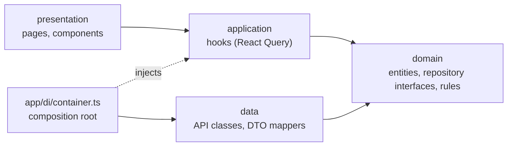

# Dashboard: React operations room

The dashboard is the operations room's single-page application, built with React 18, TypeScript and Vite.
Arabic (RTL) is the default language and English is one click away. Each page has one job:

| Route | Page | Purpose |
|---|---|---|
| `/` | Overview | KPIs, active incidents, AI priority queue, system status, mini map |
| `/map` | Operational map | Every unit on the Riyadh map, coloured by risk |
| `/units` | Field units | All vests, sorted by AI risk, filterable |
| `/units/:id` | Unit detail | Live sensors, risk explanation, trends, incidents, commands |
| `/alerts` | Alerts and incidents | Priority queue, filters, timeline, acknowledge or resolve |
| `/analysis` | AI analysis | Risk ranking, per-wearer baselines, how the model works |
| `/armor` | Armor and radiation shielding | Layer stack, lab data, Beer–Lambert calculator |
| `/fleet` | Devices and personnel | Register vests, assign wearers (admin) |
| `/settings` | Settings | Profile, password, operator accounts (admin) |

## Clean architecture

Each feature under `src/features/<name>/` has the same four layers. Dependencies point inwards only:



| Layer | Contains | May import |
|---|---|---|
| `domain/` | Entities (`Unit`, `Alert`, …), repository **interfaces**, pure rules | Nothing framework-specific: no React, no HTTP |
| `data/` | `UnitApi implements UnitRepository`, DTO → entity mappers | `domain`, `core/http` |
| `application/` | Hooks such as `useUnit(id)` that get the repository from the DI container | `domain` interfaces only |
| `presentation/` | Pages and components | `application`, `domain`, `shared/ui` |

These rules are **enforced by ESLint** (`no-restricted-imports` in `eslint.config.js`): an import that
breaks a layer fails `npm run lint` and CI. `src/app/di/container.ts` is the only place that knows the
concrete classes. Tests inject fakes through the same `Dependencies` type.

Other folders:

| Folder | Contents |
|---|---|
| `src/app/` | Router (lazy-loaded pages), providers, DI container, layout (sidebar, top bar) |
| `src/core/` | HTTP client and errors, token store, configuration, i18n, formatting, design tokens and global styles |
| `src/shared/` | UI kit (buttons, cards, badges, forms, toasts), charts, the Leaflet map, shared hooks and types |

## Run it

Requires Node 20–24.

```powershell
cd frontend
npm ci
copy .env.example .env.local     # VITE_API_BASE_URL=http://localhost:5000/api/v1
npm run dev                      # http://localhost:5173
```

Start the backend first ([backend/README.md](../backend/README.md)). If the API runs with
`PUBLIC_ACCESS_ROLE` set, the dashboard opens directly on the command overview. Otherwise sign in with an
account created by `create-operator` or the bootstrap administrator.

| Script | Does |
|---|---|
| `npm run dev` | Development server with hot reload |
| `npm run lint` | ESLint, including the architecture layer rules |
| `npm run typecheck` | TypeScript project build, no output |
| `npm test` | Vitest and Testing Library (46 tests) |
| `npm run build` | Type check, then the production build in `dist/` |
| `npm run preview` | Serve the production build locally |

## Simulation mode

Like the DUSK-1 ground station's demo source, the dashboard can run on a **built-in simulation** instead of
the real vests: for presentations when no vest is online. Turn it on with **Simulation / محاكاة** in the top
bar or in **Settings → Data source**, or open the dashboard with `?demo` (for example
`https://dera-sta-dashboard.onrender.com/?demo`; `?live` forces live data). The choice is remembered per
browser.

* **Same pages, another source.** The simulation implements the same repository interfaces as the API
  (`src/features/demo/data`), so every page works unchanged. Field data (units, alerts, overview, AI analysis,
  fleet) comes from the simulation; sign-in, operator accounts, server health and the armor calculator stay on
  the real API. Nothing is sent to the server or the vests, and nothing is saved.
* **The real fleet as the cast.** The simulation reads the registry once (names, posts, vest codes). If the
  API cannot be read, it uses the six wearers of `flask seed-demo`.
* **Logical readings.** Each wearer has a routine (an indoor post, patrols, guards). Movement drives the heart
  rate with the firmware simulator's model, exertion and smoke lower SpO₂, and the vest temperature follows
  Riyadh's air temperature for the month and hour, indoors or out. Six hours of history are simulated first,
  so every chart is full from the start.
* **The same rules as the real system.** The vest firmware's alarm rules (thresholds, persistence, the 10 s
  pre-alert) and the server's models (per-wearer anomaly detection, risk score, incident priority, contact
  lost) are ported one to one in `src/features/demo/domain/models.ts`. Acknowledge, resolve and vest commands
  work on the simulated state. A simulated duty officer acknowledges incidents left open for 3 minutes.
* **A 12-minute storyline that repeats.** The overview's *Simulation scenario* panel shows what is happening
  and what comes next. Units are taken in vest-code order (names below are those of the default fleet):

| Time | Unit | What happens | What the dashboard shows |
|---|---|---|---|
| 0:10 | ALPHA-03 | Foot pursuit | Heart rate above 160 (`HR_HIGH`); unusual activity and heart rate (AI) |
| 1:15 | ALPHA-04 | Falls and does not answer the pre-alert | Pending, then critical `FALL`; lying still: `NO_MOTION`; risk 100 |
| 3:30 | ALPHA-05 | Vehicle fire nearby | Vest above 45 °C (`VEST_TEMP_HIGH`), SpO₂ under 92 % (`SPO2_LOW`), AI anomalies |
| 5:30 | ALPHA-02 | Hard impact, then SOS | `IMPACT` and `SOS` incidents, stress heart rate |
| 7:00 | ALPHA-06 | The vest loses contact for 2 minutes | Offline, then `CONTACT_LOST` until it reconnects |
| 10:00 | ALPHA-01 | Stumbles | Fall pre-alert, cancelled by the wearer |

* **Always labelled.** A purple banner on every page, the *Simulation* switch, "Simulated" badges on units
  and incidents, and "Simulated reading" under heart rate and SpO₂. The fleet is read-only in this mode.
* The simulation engine is its own chunk, downloaded only when the simulation is switched on (about 10 kB
  gzipped).

## Configuration

| Variable | Example | Notes |
|---|---|---|
| `VITE_API_BASE_URL` | `https://dera-sta-api.onrender.com/api/v1` | Read at **build time**. Changing it in Render needs a redeploy |
| `VITE_API_HOST` | `dera-sta-api.onrender.com` | Alternative: only the host, which becomes `https://<host>/api/v1` |

## Conventions

* **Live data:** React Query polls every 3–15 s, depending on the page. Pages never call `fetch`
  directly.
* **Languages:** every visible string comes from `src/core/i18n/dictionaries/{ar,en}.ts`. The Arabic
  dictionary is typed from the English one, so a missing translation is a type error. Use logical CSS
  properties (`margin-inline-start`) so that layouts mirror correctly in RTL.
* **Roles:** actions a role cannot perform are hidden. The API enforces the same rules.
* **Look:** every colour, radius and font comes from `src/core/styles/tokens.css` (charcoal surfaces, mint
  signal colour, orange and red for danger, the active choice as a white pill). Components never hard-code
  colours. The menu is one bar across the top; below 1200 px it folds into a menu button.
* **Map:** OpenStreetMap tiles turned charcoal with a CSS filter. No API key is needed. Units are round
  badges: shield = normal, "!" = under watch, triangle = critical, × = offline.
* **Sign-in:** at start-up the dashboard asks `/auth/me` who it is. A public-access visitor goes straight in,
  `401` shows the sign-in page, and an API that is still waking up gets an automatic retry.
* **Errors:** API errors become friendly, translated messages (`shared/ui/errors.tsx`, `useErrorMessage`), and a `401`
  on a signed-in session returns to the sign-in page.

## Adding a page

1. Create `src/features/<name>/{domain,data,application,presentation}`.
2. Define the entity and the repository interface in `domain`, implement it in `data`, register it in
   `app/di/container.ts` and `app/di/types.ts`.
3. Write the hook in `application` and the page in `presentation`.
4. Add the route in `app/router.tsx` (lazy) and the menu entry in `app/layout/Sidebar.tsx`.
5. Add the text to both dictionaries. `npm run lint && npm test && npm run build` must pass.
